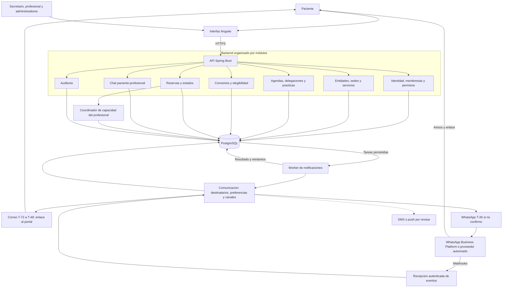
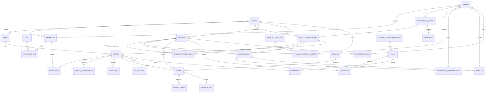
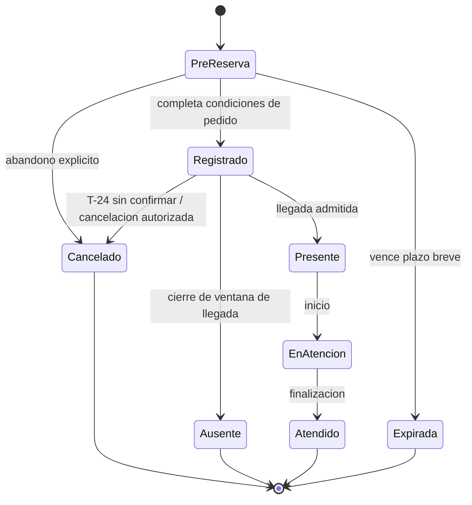

# Propuesta de V1 beta: turnero SaaS, primer incremento

Actualización: 15 de octubre de 2026. Estado: diseño aceptado y consolidado en ADR-008 exclusivamente con este chat; parámetros y especificaciones pendientes. Ver [estado consolidado](13-estado-consolidado-y-pendientes.md). Aceptación documental no significa implementación verificada.

SaaS significa software ofrecido como servicio. En este proyecto, una **entidad** es una organización cliente independiente; una **sede** es un lugar de atención dentro de esa entidad. Varias sedes del mismo cliente y varios clientes independientes requieren relaciones y permisos diferentes.

## 1. Decisiones confirmadas y objetivo

- Varias entidades desde la V1.
- Primera operación odontológica; núcleo administrativo extensible a otras especialidades, sin incorporar automáticamente funciones clínicas.
- Inciso 5 aceptado: tablas compartidas con `tenant_id`, integridad entre entidades y PostgreSQL RLS; numeración de pacientes por profesional y entidad, separada del ID interno.
- Objetivo aproximado de 20 profesionales en uso a tres meses y hasta 100 al año; mayor actividad profesional de lunes a viernes 08-20. Volumen y concurrencia por validar, sin restringir el portal al horario comercial.
- Pacientes con autogestión de selección solo para la práctica «Consulta» habilitada; todas las demás prácticas, incluidas las personalizadas, se asignan por secretaría autorizada/profesional. Chat humano de consultas adicionales al profesional en portal, según ADR-005.
- ADR-007 aclara ADR-006: personal administrativo autorizado registra al paciente o acepta solicitud antes del acceso privado. Aprobación persistente más autenticación válida y vinculación; login externo no habilita por sí solo. Formulario propio protegido y dirección de acceso Google + alternativa por correo aceptados en ADR-008; mecanismo de acceso/verificación y vínculo en otra entidad por concretar. Catálogo público es visión futura.
- Actores: paciente, representante autorizado, secretario/ayudante, profesional, administrador de entidad y administrador de plataforma. Admitir pacientes exige una facultad administrativa explícita.
- Desarrollo supervisado por etapas y commits específicos.
- Reserva previa a la confirmación, con exclusión de intervalos incompatibles del mismo profesional entre entidades.
- Delegación explícita del profesional para administrar cada agenda, limitada a personal de esa entidad.
- Autonomía del profesional, varias agendas por consultorio y baja institucional con cuenta persistente. ADR-011 confirma reconfiguración independiente con continuidad del fichaje; eliminación de cuenta/vínculos solo a petición expresa del profesional, conservando fichas e historial de pacientes. Modelo por entidad y procedimiento pendientes.
- Intervalos por práctica, configurables por el profesional o secretaría autorizada.
- Convenios de obras sociales, prepagas y coberturas similares como condición de elegibilidad.
- Confirmación por portal, con correo entre T-72/T-48 y respaldo WhatsApp T-36 sin confirmar. A T-24 cancelar/liberar y notificar en plataforma a secretaría y/o profesional autorizados. Fallos técnicos y asistencia mantienen excepciones por concretar. Menores y representantes verificados.
- ADR-004 concreta ADR-003: correo y WhatsApp como respaldo operativo requeridos para el flujo del primer incremento, sin volver WhatsApp canal principal. Proveedores y excepciones por resolver. Comunicaciones incluidas en el abono total, con precio y alcance pendientes.
- Canales de comunicación con pacientes como parte de la arquitectura, con aislamiento por entidad y destinatarios autorizados.
- Entregar una beta funcional a profesionales interesados con todo el contexto de turnos, credenciales y roles en el primer incremento.
- Evaluar controles de suscripción y tratamiento de datos por su finalización en el segundo o tercer incremento.

El detalle de estos requisitos y sus decisiones pendientes está en [Reglas R01-R12](03-reglas-del-dominio.md). La aceptación técnica del inciso 5 consta en [ADR-001](arquitectura/adr/001-aislamiento-y-numeracion-pacientes.md); el stack Angular/Spring Boot/PostgreSQL fue confirmado por separado en ADR-002.

Objetivo propuesto: permitir que cada entidad publique disponibilidad, reserve y gestione turnos, reduzca trabajo manual y pueda reconstruir quién realizó cada cambio.

El ciclo de vida incremental está detallado en [incrementos y beta](05-incrementos-y-beta.md). La seguridad básica y las reglas que evitan conflictos entre entidades son requisitos del primer incremento; la [evaluación de seguridad](06-seguridad-beta.md) distingue controles para entregar la beta y mejoras posteriores. La arquitectura de comunicación se detalla en [canales](04-canales-y-costos.md).

Métricas a validar con una entidad piloto: tiempo para reservar, proporción de turnos autogestionados, inasistencias y errores de agenda. No fijar porcentajes sin medir una situación inicial.

## 2. Alcance aceptado y evolución

### Incluido en el incremento 1: beta funcional

- Alta controlada de entidades y configuración de su zona horaria.
- Alta/invitación de personal, acceso del paciente y recuperación de cuenta.
- Admisión administrativa previa al acceso privado, por registro de personal o aceptación de solicitud propia protegida según ADR-007/ADR-008. Formulario o credencial externa válidos no dan acceso a ficha/reservas/chat sin aprobación vigente y vinculación. Definir verificación, activación y métodos de login.
- Defensa contra abuso por capas: cuotas de pre-reservas y turnos futuros incluidos confirmados, frecuencia, anti-bot, comunicaciones/gasto y revisión; parámetros por fijar y excepciones familiares. Validar antes de adquirir capacidad y ante concurrencia.
- Membresías y roles por entidad, con posibilidad de varios roles por persona.
- Profesionales, servicios, duración de atención, sedes y agenda.
- Horarios habituales y excepciones: feriados, ausencias y bloqueos.
- Consulta de disponibilidad; reserva, confirmación, cancelación y reprogramación.
- Pre-reserva temporal que bloquea capacidad y se transforma en turno pendiente de confirmación de asistencia.
- Delegaciones de agenda por profesional, personal y entidad.
- Prácticas con duración y pausas propias, y reglas de cobertura por profesional, agenda y práctica.
- Relación del paciente menor con representantes verificados y facultades delimitadas.
- Gestión desde recepción y portal bajo reglas centrales y facultades distintas: paciente elige únicamente la práctica «Consulta» habilitada; personal autorizado agenda las demás prácticas. La selección de nuevo horario al reprogramar respeta la misma restricción.
- Chat humano paciente-profesional dentro del portal para consultas adicionales, con participantes autorizados, mensajes persistidos y autoría. IA pendiente; permisos de agenda no conceden acceso automático al chat.
- Registro de llegada, atención e inasistencia por personal autorizado.
- Portal de autogestión; correo T-72/T-48 y WhatsApp T-36 sin confirmar, integrados y operativos. Cancelación/liberación T-24 y aviso interno trazable a personal autorizado. Probar el flujo de ADR-004 antes de cerrar beta.
- Auditoría de operaciones sensibles y reportes operativos básicos.
- Copias de seguridad, restauración comprobada y controles de acceso antes del piloto.

### Funciones adicionales propuestas para versiones posteriores

Historia clínica, prescripciones, facturación, cobros, liquidaciones, validación electrónica de afiliación/autorizaciones con entidades de cobertura médica, aplicación móvil nativa, integraciones con calendarios y asignación automática de lista de espera. Los convenios locales de cobertura forman parte de V1; configurar convenios no equivale a integrar una API de obra social. Portal/correo/respaldo WhatsApp aceptados en ADR-004. ADR-005 incorpora chat humano al profesional y restringe la elección de horario por paciente a la práctica específica «Consulta»; IA sigue pendiente de aprobación.

**Visión futura por analizar en ADR-006:** catálogo web público de profesionales autorizados para publicación y solicitud de empadronamiento. Reutilizar cuenta/datos administrativos no significa compartir ficha ni habilitar todas las agendas. Definir vínculo local persistente y publicación; no adelantar motor comercial de suscripciones.

**Diferido por decisión del responsable al incremento 2 o 3:** planes, cobros del SaaS, renovaciones, morosidad, suspensión y fin de suscripción, y políticas de acceso, transferencia, exportación o eliminación de datos ligadas a esa finalización. La beta tendrá incorporación controlada de entidades y cuentas, sin motor de suscripciones. Revocar accesos comprometidos o delegaciones sigue siendo una función de seguridad de la beta.

## 3. Actores y permisos

Autenticación determina quién ingresa. Autorización determina qué acción puede realizar sobre qué recurso y en qué entidad.

| Actor | Alcance propuesto | Límites principales |
| --- | --- | --- |
| Paciente | Elegir/reservar la práctica «Consulta» habilitada; ver turnos propios, confirmar y cancelar según políticas; chat al profesional | Otras prácticas y su nuevo horario los asigna personal autorizado; no accede a conversaciones ajenas |
| Representante autorizado | Gestión y chat para la persona representada dentro de facultades verificadas y mismas restricciones de selección | Vínculo familiar o contacto de emergencia no concede acceso universal |
| Secretario/ayudante | Agendar/reprogramar la práctica «Consulta» y las demás prácticas, configurar intervalos según delegación | Membresía y delegación vigentes; operar agenda no concede acceso al chat profesional |
| Profesional | Administrar agendas, prácticas, coberturas y delegaciones; responder chat autorizado y registrar atención | Mensajes acotados a entidad/participantes; desvincularse no traslada fichas, chats ni turnos automáticamente |
| Administrador de entidad | Gestionar organización, personal y funciones expresamente concedidas de su entidad | No sustituye la delegación del profesional ni recibe facultad de catálogo automáticamente; no accede a otra entidad ni crea administradores de plataforma |
| Administrador de plataforma | Dar de alta entidades, operar el servicio y gestionar incidentes | Acceso a datos de pacientes no concedido automáticamente; soporte excepcional explícito, temporal y auditado |

Ser desarrollador no concede automáticamente privilegios de producción. La cuenta de desarrollo y la de administración operativa deben tener responsabilidades separadas.

Regla de autorización propuesta:

> Usuario activo + relación válida con la entidad + permiso para la acción + alcance sobre el recurso + reglas de negocio satisfechas.

En agendas profesionales, agregar una delegación vigente cuando actúe secretaría. El administrador de entidad no sustituye el consentimiento del profesional para delegar su agenda.

Ejemplo: un secretario de la entidad A no puede leer un turno de B cambiando su identificador en una URL. Un profesional que trabaja en A y B puede tener distintos permisos en cada una.

Denegar por defecto y comprobar permisos en cada operación del servidor sigue las recomendaciones de [OWASP sobre autorización](https://cheatsheetseries.owasp.org/cheatsheets/Authorization_Cheat_Sheet.html). Los controles de navegación de Angular ayudan a la experiencia; la propia [documentación de Angular](https://angular.dev/guide/routing/route-guards) exige autorización en el servidor.

## 4. Arquitectura propuesta

**Dirección aceptada: monolito modular**, un backend desplegable organizado por capacidades de negocio. Concretar sus límites en el diseño y reevaluar con datos de carga y operación; no implica adoptar automáticamente todas las bibliotecas propuestas.

| Componente | Propuesta | Motivo |
| --- | --- | --- |
| Interfaz | Angular + TypeScript | Continuidad con proyectos existentes; vistas adaptadas a cada actor |
| API | Java + Spring Boot + Spring Security | Continuidad con Residuos; reglas y autorización centralizadas |
| Persistencia | PostgreSQL | Transacciones, relaciones, rangos temporales y políticas por fila |
| Migraciones | Evaluar Flyway | Esquema reproducible y cambios de base versionados |
| Procesos diferidos | Worker del mismo código, con tareas persistidas | Avisos y recordatorios recuperables ante fallos |
| Entorno local | Docker Compose, si resulta adecuado al equipo | Servicios y configuración reproducibles |

Angular, Spring Boot y PostgreSQL están confirmados; usar últimas versiones estables compatibles, fijadas al implementar y con seguimiento de actualizaciones. Se confirma alojamiento VPS; proveedor, autenticación concreta y dimensionamiento quedan por resolver. Las versiones observadas y el perfil de VPS propuesto constan en [presupuesto y operación](08-presupuesto-y-operacion.md). Flyway, Docker Compose y los demás detalles de esta tabla siguen como propuestas. PostgreSQL y RLS conservan el contrato del inciso 5; no existe una base a migrar.

Módulos propuestos para el incremento 1: identidad/acceso, entidades, profesionales/prácticas, pacientes/representación, agendas/delegaciones, coberturas/convenios, turnos/capacidad, chat paciente-profesional, notificaciones y auditoría. Suscripciones se estudiará en incremento 2 o 3, sin módulo vacío en beta. El coordinador de capacidad es responsabilidad interna del backend. Cada módulo separará dominio, casos de uso, HTTP y persistencia según necesidad.

## 5. Aislamiento entre entidades

**Aceptado por el responsable el 14 de octubre de 2026 como parte del contrato funcional y técnico de V1.** La implementación debe demostrar estos criterios antes de entregar la beta. Registro: [ADR-001](arquitectura/adr/001-aislamiento-y-numeracion-pacientes.md).

### 5.1. Estrategia aceptada

Tablas compartidas con `tenant_id`, relaciones que impidan mezclar entidades y políticas PostgreSQL RLS como defensa adicional. La identidad puede ser global; los datos operativos, las fichas y las membresías se vinculan a una entidad. Una identidad global no concede acceso entre entidades.

Se consideraron base por entidad y esquema por entidad. Las tablas compartidas permiten migraciones comunes y reducen la administración inicial; requieren disciplina en restricciones, autorización y restauración por entidad. Las alternativas podrán reevaluarse con evidencia de carga o nuevas necesidades de aislamiento.

### 5.2. Condiciones obligatorias de aceptación de la implementación

- Validar la entidad solicitada contra la identidad, la membresía vigente y los permisos; no confiar solamente en un encabezado o parámetro del navegador.
- Clasificar toda tabla como global o perteneciente a una entidad. Documentar propósito, acceso y responsable de cada dato global; global no significa público.
- Exigir `tenant_id` no nulo en tablas de entidad. Las relaciones entre ellas incluirán la entidad en claves foráneas compuestas o una restricción equivalente verificable; RLS no sustituye esa integridad.
- Consultas, tareas, archivos, exportaciones y cualquier caché futura deben mantener el alcance validado. Las claves de caché y referencias a archivos no sustituyen la autorización.
- El rol de base de la aplicación no será superusuario, propietario con bypass efectivo ni tendrá `BYPASSRLS`. Separar las conexiones privilegiadas de migraciones del acceso ordinario.
- Las conexiones reutilizadas establecerán y limpiarán correctamente el contexto de entidad, también ante errores. Establecerlo en cada transacción con `SET LOCAL` o equivalente, confirmar o revertir antes de devolver la conexión al pool y denegar operaciones sin contexto válido.
- Las pruebas usarán el rol real de la aplicación y su forma de conexión. Demostrar que A no puede leer, insertar, cambiar, borrar ni relacionar datos de B, ni cambiar la entidad de una fila para evadir la separación.
- Verificar cobertura de políticas en tablas nuevas y reutilización de conexiones tras éxito y error; comprobar también que las operaciones autorizadas dentro de la entidad funcionan.

RLS requiere diseño y verificación y no reemplaza los permisos del backend. Las políticas deben cubrir lectura y escritura; `FORCE ROW LEVEL SECURITY` no limita a superusuarios ni a roles con `BYPASSRLS`. Fuentes: [OWASP sobre seguridad multientidad](https://cheatsheetseries.owasp.org/cheatsheets/Multi_Tenant_Security_Cheat_Sheet.html) y [PostgreSQL sobre políticas por fila](https://www.postgresql.org/docs/current/ddl-rowsecurity.html).

**Excepción controlada: capacidad del profesional.** La exclusión entre entidades necesita una identidad profesional global verificada y un registro mínimo de ocupación común. Ese registro no expone pacientes ni detalles de agendas ajenas. Una operación interna autorizada responde disponibilidad y reserva capacidad de forma atómica. Filtrar reservas solo por `tenant_id` permitiría una doble reserva entre A y B; ver R03.

### 5.3. Numeración de pacientes por profesional y entidad

**Requisito confirmado:** cada profesional dispone de su propia serie de pacientes dentro de cada entidad. En una misma entidad, A puede tener pacientes 1 a 90 y B pacientes 1 a 33. Si A trabaja en otra entidad, allí usa otra serie; varias agendas de A en la misma entidad comparten la serie. El alcance por profesional y entidad fue confirmado expresamente por el responsable.

Separar el `paciente_id` interno, único e inmutable en el sistema, del `numero_paciente_profesional` visible. El número pertenece a la relación entre entidad, profesional y paciente: una ficha puede tener números diferentes con profesionales distintos, sin duplicarse por ese motivo. Ningún número concede acceso ni sustituye una comprobación de identidad.

**Criterio aceptado al consolidar el análisis (ADR-008), reafirmado expresamente por el responsable el 15 de octubre de 2026 en ADR-001:** empezar en 1 y asignar números crecientes al registrar por primera vez una relación profesional-paciente. Conservar el número en visitas posteriores, reactivaciones y cambios de agenda dentro de la misma entidad. No reiniciar por año, renumerar por bajas ni reutilizar números ya confirmados. Se permiten huecos por bajas o correcciones auditadas; no se exige una serie permanentemente sin huecos. Si se requiriera continuidad estricta, deberá aprobarse como requisito adicional. El total de pacientes se calcula contando relaciones según su estado, no leyendo el último número.

**Dirección de diseño aceptada; SQL pendiente:** asignación en servidor con contador transaccional por entidad y profesional y control de concurrencia. No usar `COUNT(*) + 1` ni `MAX(numero) + 1` sin serialización. Exigir unicidad de `(tenant_id, profesional_id, numero_paciente_profesional)` y de `(tenant_id, profesional_id, paciente_id)`, campos obligatorios y número positivo. Las referencias al paciente y al vínculo profesional deben pertenecer a la misma entidad. Reintentar el mismo alta devuelve la relación y el número existentes; altas simultáneas de la misma relación tampoco pueden duplicarla.

Una secuencia PostgreSQL ordinaria puede dejar huecos incluso ante transacciones fallidas: un autoincremental no garantiza continuidad estricta. El mecanismo SQL definitivo se concretará y probará en el modelado. Referencias: [secuencias](https://www.postgresql.org/docs/current/functions-sequence.html) y [restricciones](https://www.postgresql.org/docs/current/ddl-constraints.html).

### 5.4. Escala inicial y volumen derivado

**Objetivo vigente:** aproximadamente 20 profesionales en uso a tres meses y hasta 100 al año. Es una referencia de planificación, no una medición de capacidad, un límite comercial ni una estimación de sesiones simultáneas.

| Variable | 20 profesionales a tres meses | Hasta 100 al año |
| --- | --- | --- |
| Vínculos profesional-paciente, 100 por profesional | 2.000 | 10.000 |
| Turnos por mes, uno por vínculo | 2.000 | 10.000 |
| Correos de solicitud, uno por turno elegible | Hasta 2.000 | Hasta 10.000 |
| WhatsApp de respaldo, si 10% queda sin confirmar a T-36 | 200, hipótesis | 1.000, hipótesis |

Los vínculos no son pacientes únicos y el porcentaje de respaldo no está medido. 120.000 turnos anuales corresponde a un ritmo constante de 10.000 al mes, no a la incorporación gradual del primer año. Sumar altas, recuperación, cambios y avisos finales por concretar. Mayor actividad profesional L-V 08-20, sin restringir el portal ni las tareas a ese horario. Concurrencia, retención, auditoría, chat, índices y copias deben dimensionarse con datos sintéticos representativos; comprobar tiempos de respuesta y restauración antes del piloto. Ver [operación](08-presupuesto-y-operacion.md).

## 6. Modelo conceptual

Una cuenta de usuario y una ficha de paciente son conceptos diferentes. Recepción puede registrar un paciente sin cuenta. Vincular después esa ficha al portal exige comprobar identidad; conocer su nombre o documento no basta.

El diagrama muestra relaciones principales, no todas las columnas ni tablas. La etapa de modelado detallará permisos por rol, restricciones entre entidades, servicios habilitados por agenda, autor de operaciones y políticas de conservación. Toda ficha pertenece a una entidad; compartirla con otra requiere una decisión expresa.

ADR-005, ADR-008 y ADR-009 definen la selección limitada a la práctica específica «Consulta», solicitudes de admisión, vínculos de acceso y conversaciones/mensajes. La clasificación no amplía la facultad de elegir horarios. El diagrama incorpora esos objetos, sin constituir esquema SQL completo. Vínculos y participantes conservan entidad, autoría, facultades y estados; una solicitud puede resolverse sin crear otra ficha ni vínculo duplicado. La relación profesional-paciente o delegación de agenda no reemplaza autorización de conversación; las claves/relaciones deben mantener entidad y facultades.

`PACIENTE_PROFESIONAL` conserva el número visible para ese profesional y entidad, separado del ID interno de la ficha. Una ficha no se duplica por cada profesional; ver 5.3 y R01.

Ocupación coordina intervalos globales, mientras que pre-reservas, turnos y fichas mantienen su entidad. Los convenios también dependen de práctica y vigencia, pendientes de detallar. Una entidad de cobertura médica es una obra social, prepaga o similar; no significa automáticamente cliente del SaaS ni usuario con acceso.

## 7. Reglas que hacen confiable al turnero

1. **Solapamientos:** dos solicitudes simultáneas no pueden ocupar intervalos incompatibles del mismo recurso. Revisar disponibilidad antes de guardar no es suficiente. PostgreSQL admite [restricciones de exclusión sobre rangos](https://www.postgresql.org/docs/current/rangetypes.html#RANGETYPES-CONSTRAINT); deberán diseñarse y probarse junto con transacciones.
2. **Agenda efectiva:** combinar horarios recurrentes, duración del servicio, excepciones y reservas vigentes. Definir prioridad de bloqueos y qué sucede con turnos existentes cuando cambia una agenda.
3. **Estados:** aceptar solamente transiciones autorizadas, registrando actor, fecha y motivo. La reprogramación debe ser atómica y conservar historia; un intento fallido debe mantener el turno anterior.
4. **Reintentos:** una misma solicitud repetida por un fallo de red no debe crear dos turnos. Definir claves de idempotencia y su alcance por operación.
5. **Avisos:** persistir el turno y la tarea de aviso en la misma transacción —patrón outbox—. El envío ocurre después. Diseñar reintentos y deduplicación sin prometer entrega exactamente una vez de un proveedor externo.
6. **Recordatorios:** al ejecutar una tarea, verificar el estado y horario vigentes. Un turno cancelado o reprogramado no debe recibir un aviso obsoleto.
7. **Tiempo:** guardar instantes y conservar la zona horaria de la agenda para reglas recurrentes y presentación. No depender del reloj o zona del navegador.
8. **Autoría:** registrar quién hizo la reserva y para quién. Las operaciones de recepción deben ser distinguibles de la autogestión del paciente.

Modelo conceptual actualizado: separar ciclo del turno y confirmación de asistencia. Reprogramación, cancelación y llegada exigen permisos/políticas; sus detalles se concretan en el modelo de dominio.

La confirmación de asistencia tiene estados separados: pendiente, confirmada y en revisión. ADR-004: un correo de solicitud entre T-72/T-48; WhatsApp T-36 si no se confirmó; T-24 sin confirmar cancela/libera y genera aviso en plataforma a secretaría y/o profesional autorizados. Estado, liberación e historial/evento interno son consistentes. No borrar el turno ni reasignar automáticamente. Confirmación telefónica conserva autor/medio/fecha. Fallos técnicos y asistencia requieren excepciones explícitas por concretar; no cancelar por fallo de canal. Reservas cercanas, horarios de contacto y ejecución tardía pendientes. La aprobación manual del pedido solo se exige donde una política lo determine.

PreReserva bloquea hasta su vencimiento breve y Registrado conserva capacidad cualquiera sea su estado de asistencia, hasta cancelar o completar el ciclo operativo. Las transiciones y la liberación deben ser atómicas; confirmar tarde no recupera un intervalo ocupado. Ver R02, R03 y R08. Se propone atención individual sin sobrecupos; validar capacidad real por práctica.

## 8. Credenciales, privacidad y operación

- Diseñar alta, invitación, verificación de contacto, recuperación, revocación y cierre de sesión como un ciclo completo.
- Confirmado: servidor resuelve identidad y permisos por entidad/recurso; Angular presenta la interfaz según el contexto autorizado, incluso con varios roles. Registrar logins exitosos/fallidos y revocaciones relevantes sin credenciales en logs. Toda operación vuelve a comprobarse en API; ocultar funciones no concede seguridad.
- Evaluar sesiones de servidor con cookies `HttpOnly`, `Secure` y política `SameSite`, con protección CSRF, para la aplicación web. Comparar con un proveedor de identidad antes de aprobar la solución. Usar JWT no es un requisito de SaaS.
- Usar mecanismos establecidos para contraseñas, evitar secretos en Git y limitar intentos abusivos. El requisito de MFA administrativa y su evidencia se detallan en S06 de la evaluación de seguridad; mecanismo pendiente de diseño. Referencia: [OWASP sobre autenticación](https://cheatsheetseries.owasp.org/cheatsheets/Authentication_Cheat_Sheet.html).
- Auditar cambios sensibles, evitando registrar contraseñas, tokens o información sanitaria innecesaria en logs.
- Trabajar con datos ficticios en desarrollo y recopilar únicamente lo necesario para gestionar turnos.
- Definir responsables, acceso, conservación y eliminación de datos, además de avisos al paciente. Para un piloto en Argentina, revisar la [Ley 25.326](https://www.argentina.gob.ar/normativa/nacional/ley-25326-64790/actualizacion) y las obligaciones concretas aplicables antes de usar datos reales. Este documento no determina cumplimiento legal.
- Tener entornos separados, HTTPS, backups protegidos, restauración comprobada, monitoreo de errores y un procedimiento de incidentes.

Usar [OWASP ASVS](https://owasp.org/www-project-application-security-verification-standard/) como referencia para seleccionar requisitos verificables de seguridad. No declarar conformidad sin evaluar los requisitos correspondientes.

**Evaluación:** incorporar controles básicos desde el primer incremento y verificarlos antes de entregar la beta. La revisión avanzada puede ampliarse en incrementos posteriores; no postergar aislamiento entre entidades, autorización, credenciales ni recuperación de datos. La privacidad básica y la revocación por seguridad son independientes de los flujos comerciales de fin de suscripción diferidos.

## 9. Parámetros y especificaciones pendientes, en orden

1. Catálogo inicial y personalización confirmados en ADR-009: validar tiempos, pausas, recursos, ofertas reales y detalle propuesto de administración. Solo «Consulta» habilitada permite elección de horario por paciente.
2. Entidades mixtas, sedes, formulario propio y admisión administrativa aceptados: validar uso de varias sedes en piloto y configuración de agendas institucionales/autónomas.
3. Correo T-72/T-48, WhatsApp T-36 y cancelación/liberación/aviso interno T-24 aceptados: concretar aprobación excepcional, TTL, excepciones asistidas/técnicas, reservas cercanas y plazo para cancelar/reprogramar.
4. Vinculación verificada, menores y representantes aceptados: concretar procedimiento, evidencia, facultades y conflictos.
5. ¿Cómo verificamos la identidad global del profesional y protegemos la ocupación común entre entidades?
6. Objetivo 20 profesionales a tres meses y hasta 100 al año; hipótesis 100 turnos mensuales por profesional y pico L-V 08-20. Precisar entidades piloto, retención, sesiones simultáneas, VPS y objetivos de recuperación.
7. Flujo portal/correo/WhatsApp confirmado por ADR-004: elegir proveedores, verificar contacto, definir excepciones y destinatarios autorizados del aviso interno. Precio y alcance incluido pendientes; motor comercial diferido.
8. Aislamiento, stack estable, monolito modular y VPS aceptados. Dirección Google + correo y defensa por capas aceptadas; concretar sesión/recuperación, cuotas y límites, matriz compatible de dependencias, proveedor/plan y evidencia de carga; verificar políticas RLS y restricciones.

## 10. Evidencia mínima de aceptación de V1

La lista de aceptación del producto se mantiene en [criterios de entrega de beta](05-incrementos-y-beta.md#criterios-de-entrega-de-la-beta), evitando versiones paralelas. Los controles S01-S16 y sus evidencias están en [seguridad](06-seguridad-beta.md); los escenarios CAT-01 a CAT-12 y HC-01 a HC-12, sujetos a revisión de sus detalles propuestos, en el [catálogo](16-catalogo-de-practicas.md).

La implementación debe demostrar los requisitos de aislamiento y numeración del inciso 5, además de esos criterios. Registrar su resultado cuando exista aplicación; no se declaran pruebas superadas por documentarlos.
