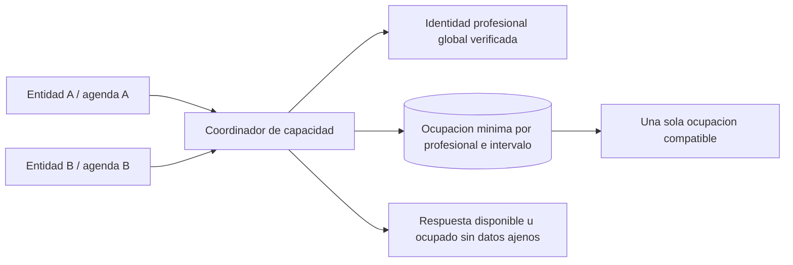

# Reglas del dominio R01-R12

Actualización: 15 de octubre de 2026. Diseño consolidado aceptado en ADR-008; especificaciones y parámetros restantes pendientes. Consolidación original basada en este chat; la ampliación R10.a usa además las fuentes técnicas citadas en docs/20. Ver [estado consolidado](13-estado-consolidado-y-pendientes.md). **Aceptado** identifica contrato: aislamiento ADR-001, producto ADR-002, flujo ADR-004, chat/selección ADR-005 y admisión ADR-006 aclarada por ADR-007. **Confirmado** indica necesidad expresada; **propuesto** cómo resolverla; **pendiente** decisión abierta. Aceptación no equivale a implementación verificada.

**Alcance incremental confirmado:** las reglas de funcionamiento de turnos, la prevención de conflictos entre entidades, las credenciales, roles y seguridad básica pertenecen al incremento 1. Portal principal, correo entre T-72/T-48, respaldo WhatsApp a T-36 y cancelación/liberación con notificación interna a T-24 confirmados en ADR-004; ambos canales deben operar para entregar ese flujo. La parte comercial de R01/R10 y las políticas de datos por fin de suscripción se evaluarán en el incremento 2 o 3. Ver [alcance de beta](05-incrementos-y-beta.md) y [seguridad](06-seguridad-beta.md).

## R01. Entidad cliente, sede y entidad de cobertura médica

**Confirmado:** un consultorio o institución puede ser cliente del SaaS y administrar profesionales asociados. El profesional también puede operar de manera independiente. El producto contempla servicio pago, pero la beta no implementa controles de suscripción.

**Aceptado para el incremento 1:** representar a cada cliente independiente como una entidad, incluso al profesional autónomo, con incorporación controlada a la beta. La sede representa un lugar de trabajo dentro de esa entidad. La identidad del profesional puede vincularse a varias entidades verificadas; puede autogestionar una agenda institucional y mantener su entidad independiente sin compartir fichas automáticamente. El vínculo comercial de suscripción se agregará después.

**Aceptado:** odontología como primera operación y núcleo administrativo extensible a otras especialidades mediante servicios/prácticas configurables. No incorpora historia clínica ni funciones clínicas especializadas. Validar prácticas, duraciones y uso de varias sedes en piloto.

**Reafirmado por el responsable en ADR-010:** la ficha dental aportada se estudia solo como referencia administrativa y de cobertura. Odontograma y demás especificaciones clínicas quedan fuera de esta versión. Se mantienen el catálogo para organizar turnos, los estados administrativos de asistencia/atención y la auditoría de operaciones. Los campos concretos de la ficha siguen en revisión; ver [análisis](18-ficha-paciente-y-cobertura-medica.md).

**Visión futura expresada en ADR-006:** catálogo público de profesionales autorizados para publicación y solicitud de empadronamiento del paciente. No forma parte automáticamente de beta ni adelanta suscripciones de I2/I3. Publicación del perfil, elegibilidad comercial y permiso de reservar son condiciones distintas. Cuenta de acceso reutilizable es compatible con aislamiento; ficha, turnos, chat y número profesional/entidad no se comparten por aparecer en catálogo o vincular otra cuenta. Concretar política entre entidades y publicación antes de implementarlas.

Una obra social, prepaga o similar se denomina **entidad de cobertura médica**. El paciente es beneficiario de una cobertura o plan. La entidad de cobertura médica y la entidad cliente del SaaS son conceptos distintos. Configurar convenios no concede a la entidad de cobertura médica acceso al portal ni a fichas de pacientes.

**Diferido al incremento 2 o 3:** titular contractual de suscripciones, planes, suspensiones, fin del servicio y tratamiento de datos asociado. Al diseñarlos, definir qué ocurre con turnos vigentes sin liberar capacidad silenciosamente. Un eventual portal/API para entidades de cobertura médica sigue como integración futura; no sustituye los convenios locales del incremento 1.

### R01.a. Aislamiento y numeración de pacientes

**Aceptado:** tablas compartidas con `tenant_id`, integridad de relaciones por entidad y PostgreSQL RLS adicional a los permisos del backend. Las condiciones obligatorias y la excepción mínima del coordinador de capacidad están en el [inciso 5](01-propuesta-v1.md#5-aislamiento-entre-entidades) y [ADR-001](arquitectura/adr/001-aislamiento-y-numeracion-pacientes.md). La aprobación no equivale a implementación.

**Confirmado:** objetivo de 20 profesionales en uso a tres meses y hasta 100 al año; serie de pacientes independiente para cada profesional dentro de cada entidad. A puede tener pacientes 1 a 90 y B pacientes 1 a 33. El número corresponde al vínculo profesional-paciente y es diferente del ID interno único de la ficha. Un mismo paciente atendido por dos profesionales puede tener un número en cada serie sin duplicar su ficha; el vínculo no concede permisos automáticamente.

**Criterio aceptado en la consolidación y reafirmado expresamente por el responsable el 15 de octubre de 2026:** comenzar en 1, conservar el número al volver o reactivar, compartir la serie entre agendas del mismo profesional en la entidad y no renumerar ni reutilizar números confirmados. La baja o inactividad del paciente 12 no modifica los números del 13 ni de los posteriores; el 12 queda reservado al vínculo original si se reactiva. Aceptar huecos por bajas o correcciones auditadas. Calcular el total de pacientes aparte, según estado y permisos; el último número no es el total actual. Esta confirmación no define borrado físico ni plazos de conservación; ver [ADR-001](arquitectura/adr/001-aislamiento-y-numeracion-pacientes.md).

**Dirección de diseño aceptada, SQL pendiente:** relación `PACIENTE_PROFESIONAL` con campos obligatorios y número positivo; unicidad de `(tenant_id, profesional_id, numero_paciente_profesional)` y `(tenant_id, profesional_id, paciente_id)`. Referencias al vínculo profesional y a la ficha dentro de la misma entidad. Asignación atómica mediante contador transaccional por serie; repetición de alta idempotente. Ver 5.3 para el detalle y las limitaciones de secuencias ordinarias.

**Aceptación funcional:** series independientes entre profesionales y entre entidades; serie común entre agendas del mismo profesional dentro de la entidad; ID interno distinto del número visible; altas simultáneas sin números ni relaciones duplicadas; reintentos sin nueva asignación. Según el criterio aceptado, desactivación/reactivación conserva número y ninguna baja renumera a otros pacientes.

**Pendiente de diseño:** SQL, índices, políticas y pruebas concretas; reglas de importación y fusión de fichas duplicadas. No asumir continuidad estricta sin huecos ni traslado automático de fichas o series entre entidades. El volumen derivado, la concurrencia y los tiempos de respuesta se validarán antes del piloto; los ejemplos de 5.4 no son una capacidad medida.

## R02. Reserva temporal antes de completar el turno

**Confirmado:** cualquier identidad autorizada debe poder bloquear el intervalo antes de la confirmación, evitando solicitudes incompatibles simultáneas.

**Aceptado:** distinguir tres hitos:

1. **Pre-reserva temporal:** ocupa capacidad durante un plazo breve mientras se completa el pedido.
2. **Turno registrado:** al completar el pedido, conserva la ocupación y queda pendiente de confirmar asistencia.
3. **Asistencia confirmada:** paciente o representante habilitado confirma que asistirá; no vuelve a reservar capacidad.

El bloqueo comienza al aceptar la pre-reserva en el servidor. Consultar disponibilidad o abrir un calendario no constituye una reserva.

**Aceptado:** registrar directamente el turno al completar condiciones de disponibilidad y elegibilidad; aprobación manual solo cuando una política explícita la exija. La pre-reserva puede ser interna a la experiencia del paciente. Su vencimiento es independiente de los plazos de confirmación de asistencia. La aceptación administrativa y la confirmación de asistencia son procesos separados; el modelo detallado conserva sus estados diferenciados.

**Restricción de ADR-005 precisada por el responsable en ADR-009:** paciente/representante solo seleccionan y pre-reservan horarios para la práctica específica **«Consulta»**, cuando esté habilitada en esa agenda. Extracción, limpieza, cirugía y todas las prácticas personalizadas se agendan por secretaría autorizada o profesional, también al elegir nuevo horario para reprogramar. Una solicitud por chat no bloquea capacidad ni equivale a turno. Validar en servidor la identidad de la práctica y las condiciones de R06; ni el nombre, la clasificación ni la duración habilitan otra práctica.

Pre-reservar exige identidad/acción autorizada, agenda habilitada, duración calculada y elegibilidad administrativa suficiente. No mantener una transacción de base abierta mientras la persona completa un formulario: persistir el bloqueo con vencimiento.

ADR-007 aclara la admisión de ADR-006: personal administrativo autorizado registra al conocido o acepta la solicitud del nuevo; acceso privado sujeto a aprobación vigente y activación/vinculación verificadas. El formulario o una credencial externa válida no ocupan capacidad ni conceden autogestión. Reservar exige además clasificación de R06. Criterios de comprobación y vínculo entre entidades siguen por concretar; no hay admisión automática general en beta.

**Pendiente:** tiempo de vida de la pre-reserva, límites de bloqueos por usuario y reglas de extensión. El abandono vence automáticamente; una renovación ilimitada permitiría retener agendas sin completar turnos.

### R02.a. Prevención de reservas abusivas

**Aceptado en ADR-008:** admisión controlada complementada por defensa por capas de la [evaluación 10](10-prevencion-de-reservas-abusivas.md). No asignar capacidad a solicitudes sin habilitación. Limitar pre-reservas/renovaciones y turnos futuros activos, **incluidos confirmados**, por paciente/profesional y con controles complementarios por actor/entidad. Aplicar límites de frecuencia por cuenta, paciente, operación y red; IP o DNI solos no identifican al autor. Controlar acumulación entre profesionales, abandonos y ciclos de cancelación/reprogramación.

Validar cuota y adquirir capacidad de manera consistente ante concurrencia; revalidar al completar, con idempotencia. Proteger formulario, invitaciones, códigos/recuperación, chat y avisos, con anti-bot, límites de gasto y alertas. Proveedor, cuotas, ventanas y umbrales pendientes; no se fijan límites numéricos en esta regla.

Restricciones graduales y revisión humana con excepciones auditadas; contemplar representante con varios menores, familias y contactos/IP compartidos. No suspender a una víctima por DNI declarado por un tercero ni cancelar masivamente turnos por sospecha. Un modo temporal de solo solicitudes conserva consulta/confirmación de turnos legítimos y operación autorizada del personal. Señales técnicas de abuso entre entidades requieren diseño mínimo restringido, sin compartir datos clínicos ni listas de pacientes sospechosos.

## R03. Exclusión del mismo profesional entre entidades

**Confirmado:** A y B no pueden ocupar simultáneamente intervalos incompatibles del mismo profesional, aunque usen agendas diferentes.

**Aceptado como criterio de producto:** identidad profesional global verificada y coordinación interna de capacidad sin revelar datos ajenos. **Diseño propuesto:** registro común mínimo para excluir intervalos: identificador profesional interno, inicio/fin, estado, vencimiento y referencias técnicas controladas. Las fichas, los turnos y sus detalles pertenecen a sus respectivas entidades.

El coordinador valida la agenda y sus permisos en el servidor; devuelve disponibilidad o conflicto sin revelar quién reservó, en qué otra entidad ni para qué paciente. Sus operaciones están acotadas y auditadas. No conceder a todos los usuarios consultas generales sobre la tabla común ni usar una conexión superusuario como acceso ordinario.

La exclusión cubre agendas de la plataforma asociadas a la misma identidad verificada. Compromisos anotados fuera del sistema requieren bloqueos manuales o una integración futura; no prometer sincronización con calendarios externos en esta V1.



**Concurrencia propuesta:** una transacción coordina las ocupaciones del profesional, libera las pre-reservas vencidas relevantes y adquiere el intervalo con una restricción de exclusión. Completar un pedido reutiliza la ocupación existente de manera atómica; no crea otra ocupación ni un instante libre entre ambas operaciones. Cancelar, reprogramar y confirmar deben usar el mismo protocolo.

La tarea de limpieza ayuda, pero no puede ser la única protección contra bloqueos vencidos. No proponer un índice dependiente de `now()` como garantía dinámica: la expiración debe representarse y resolverse explícitamente. Una confirmación tardía de una pre-reserva vencida no puede desplazar un nuevo bloqueo válido.

**Pendiente:** verificación del profesional, elección concreta de locks/restricciones, pausas entre consultorios y recursos adicionales (sillón, sala, equipamiento). No deduplicar profesionales solo por nombre ni asumir identidad basándose en un dato ingresado sin verificar.

**Aceptación:** dos entidades compiten por intervalos superpuestos y solo una obtiene capacidad; la otra recibe un conflicto sin datos ajenos. Intervalos contiguos se admiten si las pausas lo permiten.

## R04. Delegación explícita de cada agenda

**Confirmado:** secretaría administra únicamente agendas autorizadas por el profesional y dentro de la entidad en la que participa.

**Aceptado:** delegación por persona, agenda, entidad y acción, con profesional otorgante, membresía destinataria, facultades, vigencia, estado y auditoría. Separar permisos: consultar agenda, reservar, cancelar/reprogramar, registrar llegada, configurar disponibilidad y editar duración de prácticas. Una agenda adicional de otra entidad exige también vínculo autorizado con esa entidad.

La operación exige membresía vigente **y** delegación vigente **y** permiso específico. Un rol genérico de secretario no basta. Revocar una delegación debe impedir nuevas operaciones inmediatamente, aunque haya una pantalla abierta. Invitar un profesional a una institución no equivale a obtener permiso para administrar su agenda.

**Pendiente:** quién puede proponer cambios de configuración para su aprobación. La delegación a personas concretas es el criterio aceptado; una eventual delegación grupal necesitará revisión específica.

## R05. Autonomía y desvinculación del profesional

**Confirmado:** el profesional puede autogestionar sus agendas, trabajar en distintos consultorios e independizarse de una entidad.

**Aceptado:** conservar identidad global y vínculos profesionales por entidad. La agenda independiente pertenece a una entidad propia. Desvincular implica finalizar el vínculo y las delegaciones asociadas, sin alterar la identidad ni las agendas de otras entidades. El procedimiento concreto de salida sigue pendiente.

**Necesidad confirmada y aclarada en ADR-011:** el administrador de plataforma debe poder tramitar la transición del profesional desde una clínica a otra o a una entidad independiente si desea contratar el servicio individual. Conservar cuenta, identidad y todo el fichaje de pacientes vinculado al profesional para permitir su continuidad independiente; crear o activar el contexto de destino y tratar la salida del origen. El administrador de la entidad puede darlo de baja de su padrón con facultad local, sin eliminar la cuenta global ni afectar otras entidades. Un desarrollador actúa en la transición cuando tiene la facultad administrativa correspondiente. Modelado de fichaje por entidad y datos compartidos pendiente; ver [análisis de transición](19-desvinculacion-y-transicion-del-profesional.md).

**Persistencia y eliminación confirmadas:** la cuenta profesional persiste aun sin vínculo institucional activo. Su eliminación y la de sus vínculos se tramitan solo a petición expresa y verificada del profesional; el responsable aclaró que las fichas de pacientes y el historial administrativo se conservan. Definir procedimiento y referencias históricas. Cuenta persistente no concede servicio activo ni acceso vigente al contexto institucional de origen.

La continuidad del fichaje requiere una transición administrada; no concede acceso general entre entidades ni traslada automáticamente convenios o turnos institucionales. Preparar la salida con tratamiento explícito de pacientes compartidos, turnos futuros, avisos, responsables de reprogramación, ocupación común y acceso al historial según autorización.

Esta desvinculación profesional respecto de un consultorio forma parte del contexto de turnos del incremento 1. Es distinta del fin de una suscripción comercial del SaaS, cuyo ciclo de datos se difiere al incremento 2 o 3.

**Pendiente:** facultades concretas de baja institucional y transición global, procedimiento y fecha efectiva, obligaciones contractuales, modelo de continuidad del fichaje y pacientes compartidos, numeración en destino, política de turnos y eliminación de cuenta/vínculos con conservación del historial. No convertir la entidad de la clínica en la entidad personal del profesional. Un vínculo finalizado no debe dejar capacidad huérfana ni liberar turnos reales accidentalmente.

## R06. Intervalos por práctica y agenda

**Confirmado:** profesional y secretaría autorizada pueden configurar tiempos de atención según la práctica realizada.

**Ampliación confirmada por el responsable el 15 de octubre de 2026 (ADR-009):** prácticas comunes iniciales consulta, extracción, limpieza y cirugía; permitir añadir prácticas personalizadas mediante facultad explícita. La lista no es cerrada. Las duraciones, pausas, recursos, sedes y coberturas reales siguen pendientes. El [catálogo](16-catalogo-de-practicas.md) propone el detalle de campos, facultades, estados y versiones para revisión, sin darlo por aprobado ni implementado. Crear una práctica no concede selección por portal ni delegación sobre otras agendas.

**Aceptado:** núcleo administrativo configurable por servicio/práctica y profesional/agenda, comenzando por odontología. **Diseño propuesto:** habilitación por profesional y agenda, duración, pausas de preparación/cierre, horarios y excepciones; ocupación efectiva con pausas. Los tiempos se validan por oferta antes de habilitarla; no se fijan duraciones de referencia en esta regla.

Guardar en cada turno la duración y regla aplicada al reservar. Cambiar una práctica afecta futuras reservas y exige revisión explícita de las existentes. Bloquear una ausencia tampoco cancela automáticamente los turnos que ya la ocupan.

**Regla confirmada y aclarada por el responsable en ADR-009:** el paciente o representante habilitado elige horarios exclusivamente para la práctica específica **«Consulta»**, cuando su oferta en la agenda esté habilitada y cumpla las condiciones. Extracción, limpieza, cirugía y cualquier práctica personalizada son asignadas por secretaría autorizada/profesional. La restricción también cubre elegir un nuevo horario al reprogramar; el paciente puede solicitar ese cambio al personal. Conserva visualización de sus turnos, confirmación de asistencia y cancelación según facultades/políticas, incluso cuando el turno fue registrado por personal.

**Diseño propuesto para aplicar la regla:** identificar de forma estable la práctica base «Consulta» dentro de cada entidad; la clave o mecanismo concreto se definirá al modelar. Para autoselección exigir esa identidad + oferta habilitada para portal + ausencia de gestión obligatoria del personal + permisos, elegibilidad y disponibilidad vigentes. La clasificación administrativa puede conservarse para organizar el catálogo, pero no concede autoselección. Una práctica personalizada llamada «Consulta», o clasificada como consulta, sigue siendo otra práctica y no puede habilitarse para elegir horario por paciente. Configuración y duración se resuelven en servidor por personal con permiso. No hay umbral universal de minutos aprobado. Revalidar al ofrecer horarios, pre-reservar, completar y reprogramar; cambios no cancelan turnos existentes silenciosamente.

**Pendiente:** reglas por sede, desplazamientos entre consultorios, capacidad de atención individual o grupal y autorización para sobrecupos. Propuesta inicial: atención individual, sin sobrecupos.

## R07. Coberturas y convenios de atención

**Confirmado:** el profesional configura qué beneficiarios atiende según obra social, prepaga o similar, evitando reservas que no coincidan con sus convenios.

**Propuesto:** convenio con entidad de cobertura médica/plan, profesional, entidad cliente/agenda, práctica, vigencia y condiciones administrativas. La cobertura declarada del paciente se compara con ese convenio **antes de bloquear**, y se revalida al completar la reserva.

Resultado: elegible, incompatible o requiere revisión. Distinguir una cobertura declarada de una afiliación verificada y de una autorización de práctica. La configuración local no garantiza que una entidad de cobertura médica reconozca una prestación.

Si no hay compatibilidad, explicar el motivo administrativo y ofrecer opciones permitidas: otra agenda/profesional o atención particular, cuando esté habilitada y el paciente la elija. No transformar automáticamente una reserva por cobertura en atención particular con costo.

Conservar la versión del convenio/regla aplicada. Un cambio posterior genera revisión de turnos afectados y comunicación; no cancelación silenciosa. Si el paciente tiene varias coberturas, guardar la elegida para ese turno.

**Pendiente:** granularidad por plan, documentación mínima, autorización excepcional y futuros convenios/APIs de verificación. Un eventual usuario de la entidad de cobertura médica requiere un caso de uso y permisos específicos.

## R08. Confirmación de asistencia y plazos

**Aceptado en ADR-004:** un pedido de confirmación por correo entre 72 y 48 horas antes del inicio vigente de un turno registrado; enlace al portal de autogestión. No implica enviar dos pedidos por los extremos de la ventana. Registrar un instante de programación dentro del intervalo. Si a T-36 horas no hay confirmación válida y el turno sigue vigente, enviar WhatsApp con enlace al portal. Confirmar suprime avisos pendientes de esa acción; abrir/leer o ingresar sin confirmar no la sustituye. Son horas previas al inicio, no días hábiles ni vencimiento de R02.

**Aceptado a T-24:** si el turno vigente sigue sin confirmación válida, cancelar por falta de confirmación, liberar el horario y notificar dentro de la plataforma a secretaría y/o profesional autorizados de esa agenda. Conservar turno, motivo e historia. Cambio de estado, liberación y evento/aviso interno persistido deben ser atómicos o tener garantía equivalente. La notificación no reasigna automáticamente el horario ni concede acceso a agendas ajenas. La regla general de cierre queda resuelta en ADR-004.

**Excepciones previas que deben concretarse:** asistencia de secretaría para pacientes que necesitan ayuda y revisión por fallo técnico/contacto no utilizable o presupuesto agotado, conservando capacidad cuando proceda. No convertirlas en un modo predeterminado silencioso que contradiga el cierre general T-24. Sigue vigente la confirmación telefónica con autor/fecha/medio. El portal refleja la cancelación y se conserva el aviso al paciente con canal/contenido por concretar; el aviso interno a secretaría/profesional es obligatorio y no se interpreta como otro envío WhatsApp.

Aceptar el pedido no equivale a confirmar asistencia. La liberación y una confirmación concurrentes se resuelven atómicamente: una confirmación tardía no recupera un horario ocupado. Un mensaje no leído o una respuesta informal no demuestra confirmación. Aplicar la política vigente registrada y conservar historia.

El enlace usa un token aleatorio limitado al turno y acción, con vencimiento y revocación por cancelación/reprogramación. Abrir un enlace (GET) solo muestra la acción; confirmar exige interacción explícita (POST), evitando confirmaciones por previsualizadores de mensajes. No incluir documento, diagnóstico ni datos sensibles en la URL.

Una respuesta repetida es idempotente; una respuesta tardía o sobre un turno reprogramado no confirma el turno equivocado. Para menores, comprobar facultad del representante. La confirmación no sustituye el registro de llegada.

**Pendiente:** instante del correo dentro de T-72/T-48, excepciones asistidas, recordatorios adicionales, reservas con menos de 48/36/24 horas, ejecución tardía, días/horarios de contacto y secretaría, límite de cancelación/reprogramación y desempate al instante del cierre. Concretar destinatarios/gestión del aviso interno y aviso externo al paciente. Definir autenticación del confirmante según riesgo. No deducir el plazo de cancelación a partir del límite de confirmación; una respuesta posterior a cancelación no reactiva automáticamente.

## R09. Menores y representación

**Confirmado:** contemplar menores, información de tutores/representantes y autorizaciones.

**Aceptado:** separar paciente atendido, usuario que opera y persona que recibe avisos. Relación de representación con tipo, evidencia de verificación, facultades, vigencia y restricciones. Admitir varios representantes cuando corresponda; revocar acceso sin borrar la historia. Un contacto de emergencia no es automáticamente representante autorizado.

**Aceptado para vincular cuentas y fichas:** búsqueda de posibles coincidencias dentro de la entidad y verificación del vínculo; revisión humana ante ambigüedad. No fusionar por nombre, correo o teléfono únicamente ni revelar coincidencias de otras entidades. Teléfono familiar y contacto verificado no demuestran por sí solos identidad del paciente. Definir procedimiento/evidencia mínima antes del piloto; fusión de duplicados con permiso e historia.

Separar autorización administrativa para gestionar turnos, acceso a información y consentimiento sanitario para una práctica. No conceder todo el historial a un adulto que declare ser familiar. Revisar reglas al cambiar edad, representación o situación legal.

En Argentina, el artículo 26 contempla autonomía progresiva y reglas según edad y tipo de tratamiento. No adoptar una regla universal de acceso del tutor hasta los 18 años. Validar la matriz de facultades y privacidad con asesoramiento aplicable antes del piloto. Fuente: [Código Civil y Comercial, artículo 26](https://www.argentina.gob.ar/normativa/nacional/ley-26994-235975/actualizacion).

**Pendiente:** canales según edad, verificación documental, casos de conflicto, destinatario de avisos y prácticas que exigen una gestión específica de consentimiento. V1 no incluye una historia clínica completa por incorporar representación.

### R09.a. Admisión, habilitación y solicitud de empadronamiento

**Confirmado por ADR-006/ADR-007:** personal con facultad administrativa de admisión registra al conocido o acepta la solicitud protegida del nuevo. Solo después de aprobación y activación/vinculación verificadas se permite acceso al portal privado del contexto habilitado. La aprobación persiste mientras esté vigente, sin repetirse en cada login/reserva. No exigir otra cuenta por cada profesional como consecuencia del aislamiento; verificar ficha/representación y contexto.

**Acceso directo con admisión previa:** una opción como Google verifica identidad de acceso, no la autorización administrativa ni el DNI del paciente. El backend valida credencial y aprobación vigente, crea facultades locales y comprueba permisos en cada operación. Sin aprobación no abre turnos, fichas o chat, aunque el proveedor autentique correctamente. Un eventual trámite para consultar solicitud pendiente tiene alcance limitado por diseñar, sin facultades de autogestión. El actor administrativo requiere permiso explícito; el paciente no puede aprobarse ni el permiso de agenda sustituye admisión.

**Dirección aceptada en ADR-008:** formulario propio protegido, vinculación mediante invitación/activación limitada y pocos métodos de acceso: Google y alternativa por correo. Modelo de estados: solicitud pendiente, aprobado con activación pendiente, activo, rechazado y suspendido/revocado. Concretar mecanismo de correo, verificación, recuperación, plazos y transiciones antes de construir. Google Forms no integra la admisión de beta y no se añaden otros proveedores de autenticación a este recorrido. La identidad externa se vincula mediante identificador estable/proveedor y comprobación de correspondencia; no fusionar fichas/cuentas por coincidencia de DNI o correo. Personal registra datos, pero no maneja la contraseña del paciente.

**En análisis expreso:** empadronamiento a otro profesional/entidad con solicitud breve y habilitación persistente, sin repetir registro ni pedir autorización en cada reserva. Reutilizar cuenta no concede acceso automático a todas las agendas ni comparte historias. Definir alcance por entidad/profesional/agendas, sedes y cambios de contexto del mismo profesional, manteniendo aislamiento y numeración aceptados. Una solicitud de empadronamiento no equivale a un turno ni bloquea capacidad.

El DNI es dato declarado, no secreto para reclamar fichas. Contacto verificado no demuestra identidad legal. La defensa por capas de la evaluación 10 está aceptada en ADR-008; quedan pendientes cuotas numéricas, ventanas y proveedor anti-bot. Ver [análisis de formulario y catálogo](11-formulario-empadronamiento-y-catalogo.md).

## R10. Administrador de plataforma y evolución de suscripciones

**Confirmado para el incremento 1:** administrador dev/plataforma para incorporación controlada de entidades y cuentas, pruebas y operación de la beta. **Diferido al incremento 2 o 3:** controles comerciales de suscripción y reglas de datos por su finalización.

**Ampliación operativa confirmada en ADR-011:** tramitar la continuidad del profesional y su fichaje en una entidad independiente, y su incorporación a otra clínica, con facultad administrativa específica y trazabilidad. El administrador institucional puede finalizar el vínculo de su entidad; la cuenta global persiste salvo petición expresa del profesional para eliminar cuenta y vínculos, conservando fichas e historial de pacientes. El alta individual no adelanta el motor de pagos/suscripciones de I2/I3. Procedimiento, datos compartidos y autorizaciones detalladas pendientes.

**Propuesto:** separar cuenta técnica de desarrollo, administrador de plataforma y administrador de entidad. Testing ordinario en entornos separados y con datos ficticios. En producción, acciones operativas acotadas, MFA y auditoría; soporte sobre datos de pacientes mediante acceso excepcional autorizado, temporal y trazable.

Administrar entidades de beta no concede automáticamente acceso a todas las agendas. Permitir revocación de credenciales, membresías y delegaciones por seguridad desde el incremento 1. No habilitar suplantación libre de usuarios para realizar pruebas. Cambios de plan, cobros y efectos de suspensión comercial se diseñarán en los incrementos posteriores.

**Pendiente para beta:** facultades operativas y soporte acotado. **Pendiente para incremento 2 o 3:** pagos del SaaS, período de gracia, suspensión, finalización, reglas de tratamiento de datos y cobro de adicionales de mensajería.

### R10.a. Recuperación de credenciales y alta de usuarios

**Confirmado en ADR-012:** interfaz de recuperación de contraseña por email para secretaría, administradores y profesionales. Recuperar la cuenta no concede roles, reactiva membresías ni sustituye admisión. Se mantienen aislamiento, cuenta global persistente y facultades vigentes. La recuperación de MFA y cuentas exclusivamente externas tiene alcance propio.

**Propuesto para revisión:** entrada común sin seleccionar rol, instrucciones al email verificado, enlace limitado y elección personal de contraseña. Para quien gestiona la adquisición, formulario que crea o reutiliza cuenta personal verificada y solicita la entidad; plataforma revisa representación y primer administrador antes de habilitar. Separar contacto comercial de administración; invitar al equipo con permisos acotados. Alta asistida mediante invitación disponible, sin contraseñas elegidas por operadores ni registro público de administradores de plataforma.

Ver [registro y recuperación](20-registro-de-usuarios-y-recuperacion-de-acceso.md) para alternativas, pantallas, maqueta y escenarios. Mecanismo de correo del personal, política de credenciales/sesión/MFA, vigencias, límites, campos, verificación y flujo de alta pendientes de revisión. El formulario no adelanta planes, cobro ni contrato de I2/I3. No hay backend de autenticación implementado.

## R11. Avisos, automatización y presupuesto

**Confirmado por ADR-003/ADR-004:** portal principal, correo T-72/T-48 y WhatsApp T-36 si no hay confirmación; integración real requerida en beta. Proveedores, remitentes y costos pendientes. **ADR-005 incorpora chat humano paciente-profesional al portal**; IA sigue pendiente. La arquitectura mantiene canales y reglas de turno diferenciados.

**Dirección comercial aceptada:** costo de comunicaciones incluido en el abono total, sin recargo sorpresivo por API. Precio, alcance incluido y selección al contratar siguen por evaluar. Los controles comerciales de suscripción continúan diferidos. Ver [portal, correo y abono](09-portal-correo-y-membresia.md).

**Propuesto:** adaptadores de canal independientes del turno; tareas persistidas junto a la reserva, reintentos acotados y revisión del estado vigente antes de enviar. Registrar entrega/fallo y costo atribuible a la entidad; recibir webhooks autenticados y deduplicar eventos.

Cada configuración, tarea, credencial del proveedor, destinatario y evento debe resolverse dentro de una entidad autorizada. Un webhook no puede elegir libremente entidad o turno a partir de datos sin verificar. Correlacionar eventos con mensajes emitidos y cuentas verificadas; no tratar respuestas informales como confirmación automática. Ver [arquitectura de comunicación](04-canales-y-costos.md).

La autorización para recibir mensajes debe poder acreditarse y retirarse. Elegir destinatario autorizado, particularmente en menores. Mantener contenido mínimo y un portal como destino para la gestión. La cuota del canal no debe destruir reservas ni impedir consultar el portal.

**Criterio de diseño recomendado para correo:** verificar contacto mediante acción explícita; distinguir envío, entrega al servidor, apertura/clic y acción autorizada en portal. No confirmar/cancelar ni considerar al paciente inactivo por un píxel de apertura. Correo de aviso no habilita acceso a toda la ficha ni gestión automática por respuesta libre. El respaldo T-36 y el cierre T-24 dependen de confirmación pendiente, no de lectura. Rebotes/quejas requieren tratamiento operativo y delimitación de excepciones según ADR-004.

El costo del SaaS, la tarifa de Meta y el costo/comisión del proveedor son conceptos distintos. Configurar presupuesto por entidad, avisos de consumo y alternativa si el canal falla o alcanza el límite. Ver [canales y costos](04-canales-y-costos.md).

En el incremento 1 se estudian y controlan los costos técnicos del canal para operar la beta. Los planes, cuotas comerciales, excedentes facturados y cobro automático de adicionales se difieren al incremento 2 o 3.

### R11.a. Chat del portal para consultas al profesional

**Aceptado en ADR-005:** paciente y profesional intercambian consultas adicionales y respuestas dentro del portal. El chat humano forma parte del primer incremento. **Diseño propuesto:** mensajes persistidos con entidad, paciente, profesional, autor real, fecha/hora y estado de lectura/atención, con respuesta diferida; concretar horarios y expectativas de respuesta.

Autorizar en servidor lectura, envío y respuesta según participantes y entidad. Representantes solo con facultad verificada; otros familiares, pacientes, entidades y profesionales no obtienen acceso automático. Delegación de agenda a secretaría no concede lectura del chat; cualquier participación administrativa requiere permiso específico por diseñar. Definir contacto previo al primer turno, conservación, correcciones, revocación y límites de mensajes antes de implementar.

Un mensaje no confirma, cancela, pre-reserva ni reprograma por inferencia. Pedidos sobre prácticas gestionadas por personal pueden iniciar gestión humana sin elegir ni bloquear horarios. Las acciones de agenda requieren operación explícita autorizada. Avisos de mensajes nuevos en portal; avisos externos adicionales quedan sujetos a política/costo/permiso y no reutilizan el WhatsApp T-36 por cada mensaje. IA, adjuntos y llamadas no se aprueban por este requisito.

### R11.b. Reprogramación por motivos del profesional

**Confirmado expresamente en [ADR-013](arquitectura/adr/013-reprogramacion-profesional-por-whatsapp.md):** una reprogramación originada por el profesional para una fecha o uno o varios intervalos debe generar aviso **por WhatsApp a todos los pacientes con turnos vigentes afectados**, incluidos los ya confirmados, con enlace al portal para gestionar nuevos turnos. Representantes y destinatarios requieren facultades vigentes. Es un aviso propio del evento, independiente del respaldo T-36; no espera a esa ventana ni exige falta de confirmación.

Se mantiene R02/R06: autoselección únicamente de la práctica «Consulta» habilitada; otras prácticas se derivan desde el portal a personal autorizado. No asignar automáticamente horarios ni considerar el envío, lectura, clic o respuesta libre como reprogramación efectiva. Conservar motivo, turno original, autor y trazabilidad del reemplazo.

El [flujo de canales](04-canales-y-costos.md#reprogramación-por-motivos-del-profesional-whatsapp-obligatorio) propone la operación por lote, bloqueo de indisponibilidad, persistencia por turno/destinatario, deduplicación y seguimiento asistido. Permisos detallados, estados de transición, plazos, plantilla, contacto, falta de disponibilidad y reintentos se revisan antes de implementar. Cada entidad procesa exclusivamente sus agendas y pacientes autorizados; un fallo de entrega queda pendiente de resolución, sin darse por notificado.

## R12. Auditoría, trazabilidad y memoria del proyecto

**Aceptado:** historial cronológico de operaciones relevantes, accesos y consultas sensibles. Registrar autor real, entidad, agenda, paciente destinatario/representado, acción, fecha/hora, resultado, cambios relevantes y motivo, con acceso restringido. Distinguir humanos de automatizaciones y registrar política aplicada. Cancelar/corregir conserva historia. Cada turno indica práctica, duración, cobertura elegida y reglas aplicadas. No registrar tokens, credenciales ni capturar cada pulsación/formulario indiscriminadamente. Detallar la matriz de eventos y la conservación.

Las operaciones de recepción, profesional, paciente y representante deben distinguirse. Idempotencia y control de concurrencia se aplican a reserva, expiración, confirmación, cancelación y reprogramación.

El chat conserva autoría y acceso restringido; auditar sus operaciones relevantes sin copiar todo el contenido a logs generales. Registrar rechazo de selección no autorizada de práctica y cambios administrativos de clasificación/modalidad con permiso específico.

Mantener identificadores R01-R12 en historias, criterios de aceptación, ADR y revisiones. El detalle de numeración y aislamiento aceptado se localiza en R01.a y ADR-001. La hoja A4 resume el diseño; las reglas y decisiones aprobadas conservan el detalle. Actualizar el resumen y regenerar el imprimible cuando cambie una regla.

## Flujo de reserva propuesto

```mermaid
sequenceDiagram
    actor Actor as Paciente, representante o personal
    participant API as Backend
    participant Permisos as Acceso y delegaciones
    participant Convenios as Practicas y coberturas
    participant Capacidad as Coordinador global
    participant DB as Base de datos
    Actor->>API: Pre-reservar agenda, practica e intervalo
    API->>Permisos: Validar identidad, admision vigente, entidad y facultades
    API->>Convenios: Validar seleccion por actor, calcular duracion y elegibilidad
    API->>Capacidad: Validar cuota y adquirir intervalo de forma consistente
    Capacidad->>DB: Transaccion: limpiar vencidas y excluir solapamientos
    DB-->>Capacidad: Capacidad adquirida o conflicto
    Capacidad-->>API: Pre-reserva con vencimiento o conflicto
    API-->>Actor: Resultado sin detalles de otras entidades
    Actor->>API: Completar pedido con identificador de pre-reserva
    API->>Permisos: Revalidar facultades
    API->>Convenios: Revalidar practica, elegibilidad y limites
    API->>DB: Transaccion: convertir ocupacion, guardar turno y tarea de aviso
    API-->>Actor: Turno registrado, pendiente de asistencia
    Note over Actor,DB: Confirmar asistencia sucede despues y conserva la ocupacion
```

## Decisiones abiertas para las próximas revisiones

| ID | Decisión | Regla |
| --- | --- | --- |
| D01 | Vencimiento, límites y renovación de pre-reservas | R02-R03 |
| D02 | Identidad profesional global, tiempos de traslado y recursos | R03-R06 |
| D03 | Facultades de delegación, titulares y revocación | R04 |
| D04 | Procedimiento de desvinculación y turnos futuros | R05 |
| D05 | Base inicial y personalización confirmadas en ADR-009; validar duración, pausas, capacidad y ofertas reales; revisar detalle propuesto de catálogo | R06; docs/16 |
| D06 | Planes, vigencia, verificación y excepciones de cobertura | R07 |
| D07 | Instante del correo, excepciones asistidas/técnicas, turnos cercanos, ejecución tardía, carrera T-24 y cancelación voluntaria; cronograma general resuelto | R08 |
| D08 | Representación, privacidad y canales para menores | R09 |
| D09 | Proveedor de avisos y presupuesto operativo de beta; concretar lote de reprogramación, estados, plantilla, plazos, contacto, reintentos y resolución asistida. WhatsApp obligatorio para este evento confirmado en ADR-013 | R10-R11.b; incremento 1 |
| D10 | Suscripciones, cobro de adicionales y datos por fin del servicio | R01-R10-R11; incremento 2 o 3 |
| D11 | Carga derivada de 100 profesionales, retención, concurrencia y tiempos de respuesta | R01.a; inciso 5.4 |
| D12 | Modelado de numeración, importación y fusión de fichas; revisar criterio de huecos si se exige continuidad estricta | R01.a; inciso 5.3 |
| D13 | Participantes, alta de conversación, respuesta, conservación y avisos del chat; mecanismo técnico para restringir selección a la práctica base «Consulta», sin reabrir esa regla confirmada | R02-R06-R11.a; ADR-005/009 |
| D14 | Admisión del paciente: campos, verificación, activación/recuperación, estados y alcance local. Recuperación por email del equipo confirmada; revisar mecanismo y alta del solicitante comercial de docs/20. Política entre entidades/catálogo diferida | R01-R09.a-R10.a; ADR-006/007/008/012 |
| D15 | Valores/ventanas de cuotas, anti-bot, límites de solicitudes/chat/códigos/costos y respuesta al abuso; estrategia por capas aceptada | R02.a-R09.a-R11; ADR-008 |
| D16 | Sesión, versiones fijadas y proveedores; perfil de VPS medido, presupuesto integral y objetivos RPO/RTO | R10-R11; docs/08 |

Las decisiones ya resueltas se reflejan directamente en las reglas anteriores. El [estado consolidado](13-estado-consolidado-y-pendientes.md) prioriza los pendientes y los ADR registran los antecedentes y sustituciones. El requisito puede estar confirmado mientras su implementación sigue pendiente.
