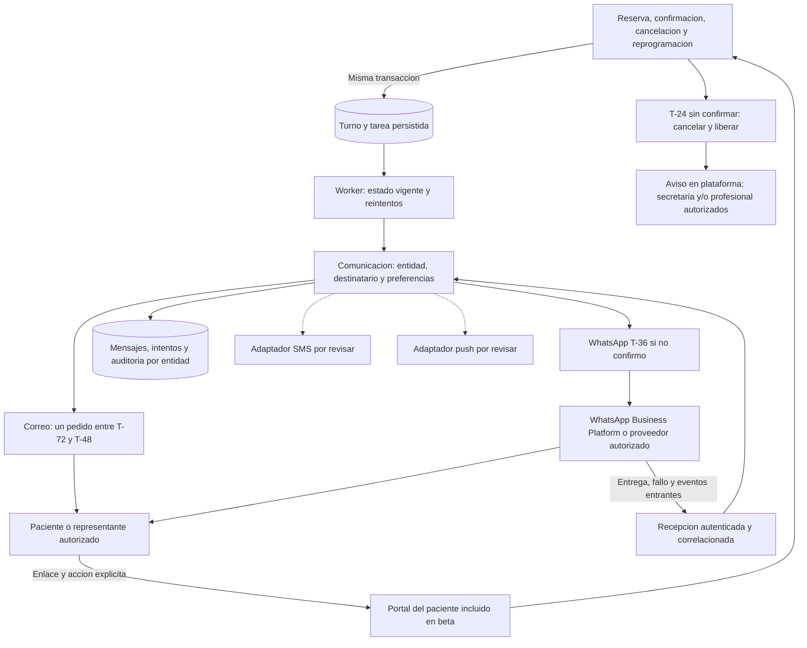

# Canales, políticas y costos de avisos

Consolidación: 15 de octubre de 2026, exclusivamente desde este chat y archivos locales. Fuentes y tarifas previas conservadas sin nueva verificación; síntesis en [estado consolidado](13-estado-consolidado-y-pendientes.md). **Portal principal, correo entre T-72/T-48 y respaldo WhatsApp a T-36 aceptados en ADR-004. A T-24 sin confirmar: cancelar/liberar y avisar en plataforma a secretaría y/o profesional autorizados.** Ambos canales se requieren para entregar ese flujo; WhatsApp sigue siendo respaldo. Proveedores, costos y excepciones pendientes; no existe implementación ni contratación. Ver [comunicaciones y abono](09-portal-correo-y-membresia.md) y [presupuesto y operación](08-presupuesto-y-operacion.md).

**Alcance incremental:** portal y flujo correo/WhatsApp/aviso interno del incremento 1 deben verificarse con proveedores reales y destinatarios autorizados. No confundir simulación con integración operativa. Precio y alcance comercial se estudian, con implementación de suscripciones diferida al incremento 2 o 3. Controlar consumo técnico no requiere construir facturación del SaaS.

## Arquitectura de comunicación del primer incremento

La comunicación es una capacidad interna del backend modular, independiente de las reglas centrales del turno. El flujo de reserva persiste eventos/tareas y no depende de esperar una llamada de red a WhatsApp. La arquitectura permite añadir canales mediante adaptadores con un contrato común, sin duplicar reglas de confirmación o autorización.



Responsabilidades propuestas:

| Componente | Responsabilidad |
| --- | --- |
| Reglas de turnos | Decidir la acción permitida y conservar sus estados; no interpretar entrega como asistencia confirmada |
| Tareas/worker | Persistir avisos, ejecutar, reintentar de forma acotada y descartar recordatorios obsoletos |
| Orquestación de comunicación | Resolver entidad, destinatario, permiso/preferencia, plantilla, canal habilitado y presupuesto técnico |
| Adaptador WhatsApp | Enviar mediante API oficial, devolver referencia del proveedor y normalizar los eventos admitidos |
| Recepción de eventos | Autenticar y correlacionar webhooks, deduplicar y derivar respuestas no reconocidas a atención operativa |
| Registro por entidad | Mantener mensaje, turno relacionado, intentos, referencia externa, categoría y estados de entrega/fallo con acceso restringido |
| Portal | Permitir consulta y acciones explícitas de paciente/representante, con autenticación o token limitado según diseño aprobado |

### Aislamiento y reglas entre entidades

- Cada configuración de canal pertenece a una entidad y vincula una cuenta/remitente del proveedor verificados. Las credenciales se almacenan como secretos y no se exponen a usuarios ni a otras entidades.
- Registrar entidad y destinatario en la tarea; revalidar permisos, contacto y estado del turno al ejecutar. No enviar el aviso de A desde una identidad de B.
- Correlacionar un webhook con una cuenta y un mensaje conocidos; no confiar en un `tenant_id` recibido sin verificación ni permitir que un evento cambie un turno ajeno.
- Aplicar autorización por entidad a historial de mensajes, configuración, reenvíos y respuestas. El coordinador global de capacidad no comparte fichas ni comunicaciones.
- Separar entrega, lectura, respuesta y confirmación explícita de asistencia. El portal sigue usando las mismas reglas de negocio que recepción.
- Un fallo del canal debe quedar registrado y tener reintento/tratamiento operativo; no cancelar un turno por fallo de WhatsApp.

### Flujos de comunicación para concretar en beta

Comprobante de turno registrado, solicitud de confirmación de asistencia, recordatorios y avisos de cancelación o reprogramación, según el cronograma y preferencias acordados. Cada mensaje utiliza un destinatario autorizado y contenido mínimo.

Incluir recepción de estados de entrega/fallo y tratamiento de eventos admitidos por la integración. ADR-005 incorpora chat humano del paciente con el profesional dentro del portal; la IA sigue pendiente. El chat tiene conversaciones y permisos propios, con aviso interno de pendientes. Una respuesta libre por chat/correo/WhatsApp no cambia un turno por inferencia. Los avisos externos por cada mensaje de chat requieren política y presupuesto específicos; no se agregan al cronograma T-36 automáticamente.

La verificación integral debe demostrar correo y WhatsApp oficiales operativos para este flujo, con contactos de prueba autorizados y recepción/correlación de eventos. Después se validará la configuración de cada entidad del piloto. Un simulador no demuestra cobertura operativa; no anunciar un canal como disponible hasta verificar su integración.

**Resolución ADR-004:** el flujo ya exige correo y WhatsApp de respaldo operativos. El instante de T-36 y la cancelación/liberación T-24 están aceptados, sustituyendo la incertidumbre de ADR-003. El aviso interno de liberación debe persistirse consistentemente con la cancelación, conservar autoría/motivo y limitarse a destinatarios con permisos vigentes. Fallos técnicos y casos asistidos se delimitan como excepciones, sin cambiar la regla general.

### Reprogramación por motivos del profesional: WhatsApp obligatorio

**Requisito confirmado en [ADR-013](arquitectura/adr/013-reprogramacion-profesional-por-whatsapp.md):** ante una reprogramación por motivos del profesional, avisar **expresamente por WhatsApp** a todos los pacientes con turnos vigentes afectados por la fecha o los intervalos seleccionados, con enlace a la plataforma de autogestión para gestionar nuevos turnos. Incluye turnos con asistencia ya confirmada. Para pacientes representados, notificar al destinatario autorizado. El WhatsApp se genera por el cambio: no espera a T-36 ni depende de confirmación pendiente. Un correo complementario no sustituye este envío.

**Recorrido operativo propuesto para revisión:**

1. Profesional o personal con facultad específica registra entidad, agendas autorizadas, fecha o intervalos de indisponibilidad y motivo interno. Presentar los turnos y destinatarios afectados antes de aplicar el lote. Incluir todo turno vigente cuya ocupación se superponga al período, aunque comience antes; no avisar a turnos ya cancelados, atendidos o ajenos al alcance.
2. Al aplicar la operación, impedir nuevas reservas en el período afectado y resolver los turnos alcanzados de manera consistente con el coordinador de capacidad. Conservar el turno original y su confirmación histórica, marcar que requiere reprogramación e invalidar sus enlaces/tareas de confirmación obsoletos, incluido el cierre por falta de confirmación. El estado exacto y la liberación de la ocupación original se concretan antes de implementar; no ofrecer como disponible un período en que el profesional no atenderá.
3. Persistir el evento y las tareas de WhatsApp por turno/destinatario junto con el cambio, o con garantía equivalente. Revalidar estado, autorización y contacto al ejecutar. Identificar operación, turno, versión y destinatario para que reintentos o intervalos superpuestos no generen avisos lógicos duplicados. Registrar intentos y posibles duplicados del proveedor sin prometer entrega exactamente una vez.
4. Enviar mensajes individuales con entidad, referencia mínima al turno afectado, indicación de que necesita reprogramarse y enlace al portal. No usar grupos ni divulgar la lista de pacientes o el motivo privado del profesional. Propuesta de texto: «Tu turno del [fecha] a las [hora] con [profesional] en [entidad] necesita reprogramarse por un cambio de agenda. Ingresá a [enlace al portal] para gestionar un nuevo turno o solicitar asistencia».
5. En el portal, paciente o representante elige un nuevo horario solo para la práctica «Consulta» habilitada y sujeto a disponibilidad, cobertura y permisos. Otras prácticas se derivan a personal autorizado. Si no hay horarios, contacto utilizable o acceso habilitado, dejar gestión asistida pendiente. El enlace no concede acceso ni admisión por sí solo. No asignar automáticamente otro profesional, práctica, entidad ni horario.
6. Al completar el reemplazo, vincularlo al original y aplicar las reglas de reserva y confirmación al nuevo turno. Resolver concurrencia y reintentos para evitar reemplazos duplicados. Un WhatsApp entregado, leído o abierto no significa que el paciente ya obtuvo otro turno.
7. Mantener seguimiento por turno: aviso pendiente/enviado/fallido, entrega técnica cuando exista y reprogramación pendiente/resuelta. Reintentos acotados y fallos a una bandeja de personal autorizado, sin ocultar a pacientes no contactados. El lote solo se cierra cuando cada caso tiene reemplazo o resolución asistida explícita y auditada; los estados concretos se revisan antes de construir.

**Pendientes del detalle:** facultad para iniciar/aprobar el lote; zona horaria y límites de los intervalos; turnos en curso o próximos; plazo de envío; plantilla y autorización de contacto; reintentos; destinatarios compartidos; falta de disponibilidad; estados del original y política de liberación/cierre. Un cambio que abarque varias entidades se procesa con autorización y mensajes separados por entidad. Este flujo pertenece al incremento 1; no está implementado ni verificado.

Sumar sus mensajes y reintentos al presupuesto técnico por entidad como evento distinto del respaldo T-36. La cuota agotada o el fallo del canal no justifican dar al paciente por avisado; requieren seguimiento asistido.

## WhatsApp: validación pendiente del proveedor

La integración usa WhatsApp Business Platform de forma directa o mediante proveedor autorizado, según decisión pendiente. Antes de contratar o enviar se deben verificar tarifa por mercado/categoría, condiciones de la ventana de atención, plantillas, autorización del destinatario, bajas, cuenta/número y cargos del intermediario.

No se conserva como regla vigente ninguna afirmación previa sobre cupos gratuitos o cambios tarifarios no revalidados. Esos antecedentes están en el [archivo histórico](archivo/2026-10-15-analisis-sustituidos.md). El [modelo de costos](09-portal-correo-y-membresia.md) mantiene supuestos fechados separados de una cotización.

Fuentes para esa validación futura: [documentación de precios de Meta](https://developers.facebook.com/documentation/business-messaging/whatsapp/pricing) y [política de mensajes](https://whatsappbusiness.com/policy/). Esta limpieza no consulta esas páginas ni declara vigentes sus condiciones.

### Propuesta de integración

- API oficial de WhatsApp Business Platform, directa o a través de un proveedor autorizado, según costo y operación.
- Evaluar cuenta/número propios por entidad y proceso de incorporación: identidad visible, permisos, facturación y portabilidad deben quedar claros.
- Enviar avisos breves con enlace al portal. Minimizar información sobre paciente, cobertura o práctica, que puede ser sensible.
- Confirmación explícita en portal; entrega, lectura o apertura del enlace no confirman asistencia.
- Registrar evidencia de autorización de contacto, destinatario, plantilla, categoría, entrega/fallo y atribución de consumo.
- Verificar webhooks, deduplicar eventos, conciliar costos y limitar reintentos. Consultar el turno vigente antes de enviar cada recordatorio.
- No dar por supuesta la continuidad ante falta de pago, rechazo de plantilla o suspensión del canal; activar revisión y canal alternativo autorizado.

## Comparación inicial de canales

La tabla compara propiedades operativas. No son cotizaciones de proveedores; antes de contratar se comprobarán precios, soporte y disponibilidad.

| Canal | Uso propuesto | Costos y limitaciones a estudiar |
| --- | --- | --- |
| WhatsApp Business Platform | Respaldo T-36 sin confirmar y aviso obligatorio por reprogramación del profesional a todos los afectados, incluso confirmados; incremento 1 | Mensajes de cada evento, proveedor, incorporación, plantillas y autorización de contacto |
| Correo electrónico | Pedido de confirmación entre T-72/T-48 con enlace al portal | Proveedor, autenticación del dominio, rebotes, spam y contacto verificado |
| SMS | Respaldo opcional para avisos críticos | Precio local por segmento, remitente, entrega, permisos y límite de contenido |
| Portal del paciente | Consulta y confirmación como parte central del SaaS | Requiere que el paciente ingrese; no garantiza un aviso externo |
| Notificación web push | Alternativa posterior de recordatorios | Permiso del usuario, compatibilidad/dispositivo y renovación de suscripciones |
| Llamada de recepción | Excepción o paciente sin acceso digital | Trabajo del personal, trazabilidad y protección de identidad |

**Confirmado en beta:** portal, correo T-72/T-48, WhatsApp T-36 y cierre T-24; ADR-005 agrega chat humano al profesional y selección de horarios por paciente solo para la práctica «Consulta» habilitada. Otras prácticas se gestionan por personal autorizado, con confirmación del paciente disponible para turnos propios ya registrados. SMS/push e IA siguen pendientes. Fallas técnicas/cupos requieren tratamiento operativo, sin cancelar por ese motivo ni enviar por canales no autorizados.

## Modelo de costos del SaaS

**Dirección comercial aceptada:** integrar costos de comunicaciones en el abono total, evitando recargos sorpresivos por API y explicitando alcance. El [modelo de comunicaciones y abono](09-portal-correo-y-membresia.md) reúne los supuestos del flujo aceptado; las alternativas sustituidas están archivadas. Precio, cupos y condiciones no aprobados; motor comercial para incremento 2 o 3. El incremento 1 necesita presupuesto, responsable del proveedor y límites técnicos que preserven continuidad del portal.

```text
Costo mensual del canal =
  suma(mensajes cobrables por mercado/categoria/nivel x tarifa vigente)
  + cargo fijo y/o variable del proveedor
  + infraestructura y operacion atribuibles
  + tributos aplicables
```

El precio comercial debe cubrir esos costos y el soporte/margen acordado. Las tarifas tienen fecha de vigencia y moneda; registrar versiones y no codificarlas como constantes permanentes. La conversión monetaria y los tributos se evaluarán al definir el contrato.

Para estimar volumen, multiplicar turnos elegibles por el único correo de solicitud y sumar los respaldos T-36 que efectivamente correspondan. No multiplicar todos los turnos por tres avisos como requisito del flujo. Los demás eventos se presupuestan por separado.

Recomendación de operación: mostrar consumo estimado y conciliado por entidad, aviso antes del límite y una política de continuidad. Los presupuestos no deben provocar cancelación de turnos o pérdida de acceso al portal.

## Decisiones pendientes

1. Integración directa o proveedor, propiedad de cuenta y número, y quién paga a Meta.
2. Plantillas mínimas y su categorización efectiva.
3. Tabla Argentina verificada y cotización total vigente.
4. Correo único en ventana, respaldo T-36 y cierre T-24 resueltos. Reprogramación del profesional: aviso obligatorio por WhatsApp confirmado en ADR-013; concretar lote, estados, plantilla, plazo, reintentos y seguimiento. Delimitar otros avisos, excepciones asistidas/técnicas, turnos cercanos y comunicación final al paciente.
5. Para beta: límite técnico de gasto y alternativa al agotar el canal. Para incremento 2 o 3: cuota comercial y cobro de excedentes.
6. Contactos y autorizaciones para adultos, menores y representantes.

Estas decisiones corresponden a R08-R11 y ADR-004: cronograma y cierre aceptados; proveedores, remitentes, contacto, excepciones y alcance comercial pendientes. La facturación del SaaS es independiente de pagos de pacientes o prestaciones a entidades de cobertura médica.
