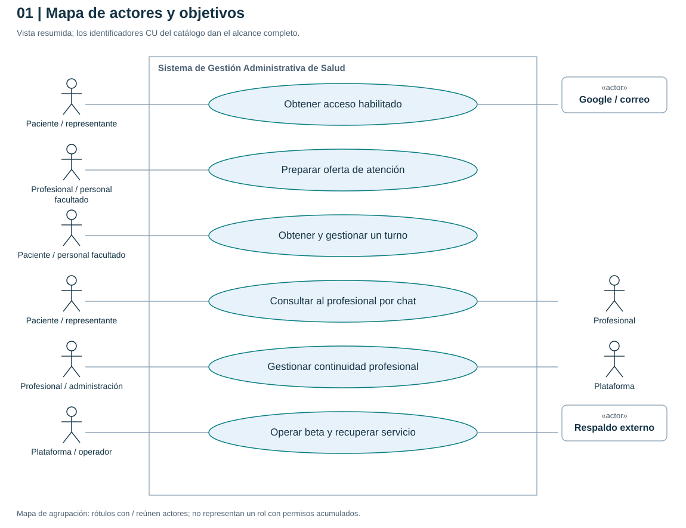
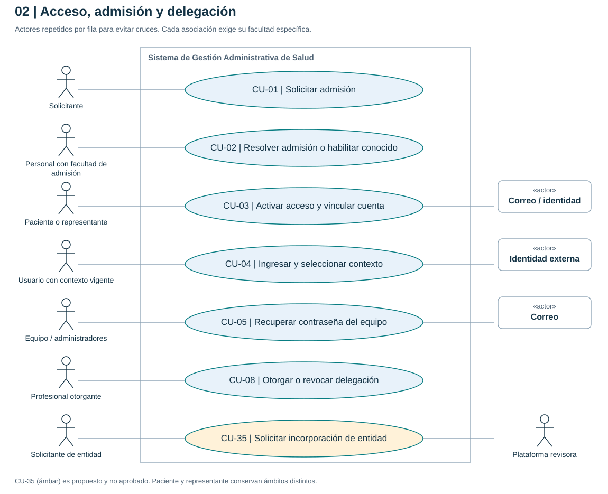
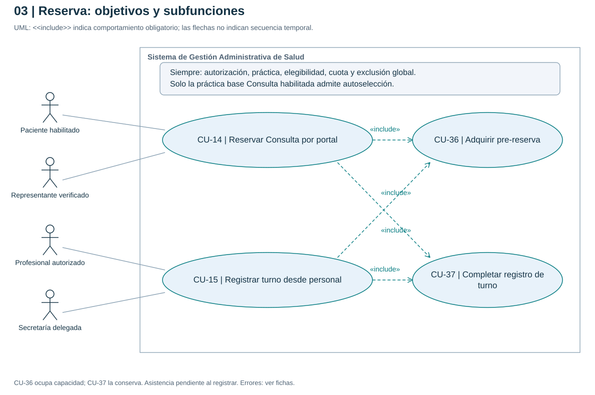
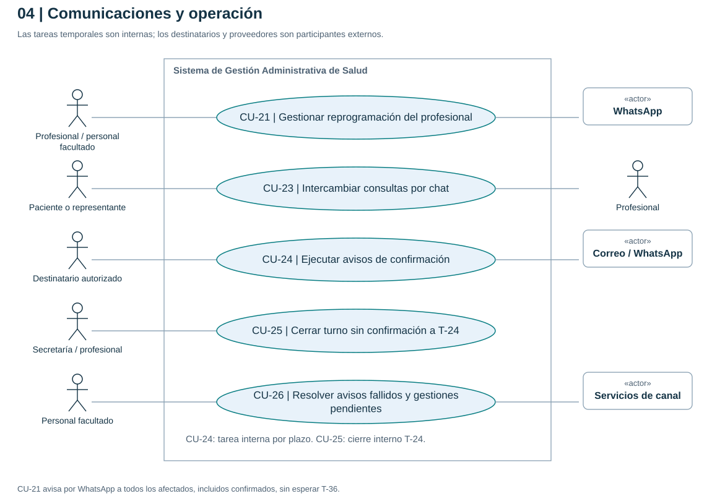
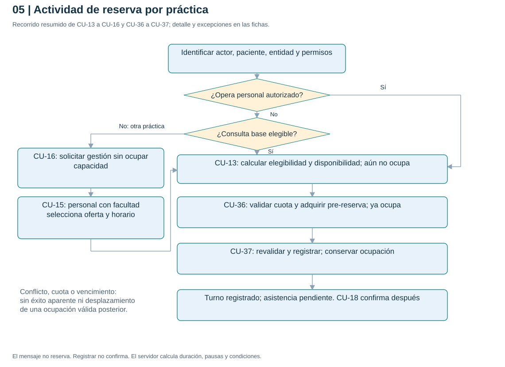
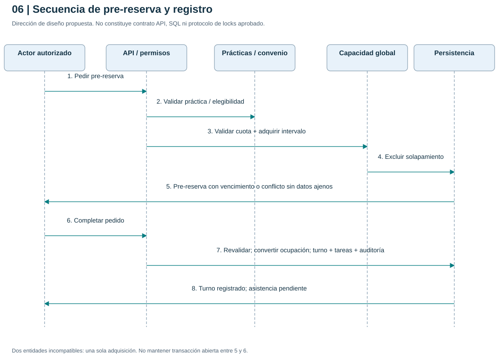
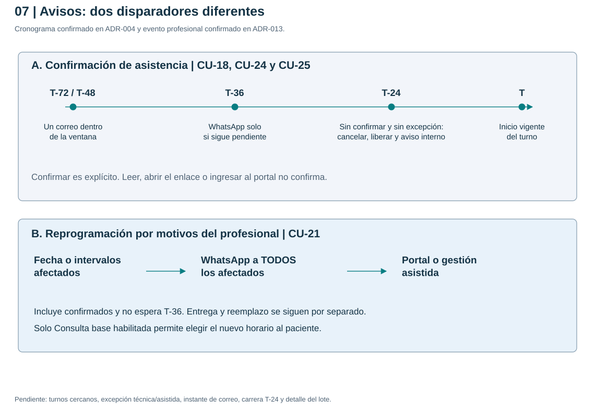

# Casos de uso del Sistema de Gestión Administrativa de Salud

Versión documental: 1.0. Fecha: 16 de octubre de 2026. Incremento 1, análisis del dominio. Estado: especificación preparada para revisión; sin aplicación ni pruebas funcionales ejecutadas.

## 1. Propósito, alcance y lectura

Describir qué resultado obtiene cada actor, en qué contexto puede obtenerlo y qué debe ocurrir cuando una operación falla. Esta especificación deriva de la documentación vigente hasta ADR-013. No sustituye las reglas R01-R12 ni convierte propuestas anteriores en decisiones aprobadas. La descomposición en casos, los recorridos detallados y los diagramas son una propuesta de especificación para revisión.

El sistema comprende portal, administración, API, persistencia, coordinación de capacidad, tareas programadas y auditoría. Google, correo, WhatsApp y el almacenamiento externo de respaldos son servicios externos. La base de datos, el planificador y el coordinador son componentes internos, no actores del diagrama de casos de uso. Una entidad cliente es un contexto de datos; una obra social o prepaga es una cobertura y no recibe acceso por configurar un convenio.

Fuera de beta: historia clínica, odontograma, facturación y cobros de pacientes, motor de suscripciones, directorio público, empadronamiento simplificado entre entidades, IA, adjuntos, llamadas, calendarios externos y asignación automática de lista de espera. CU-35 documenta una propuesta de alta para revisar; su presencia no aprueba ese recorrido ni adelanta cobros de I2/I3.

Lectura recomendada: actores y restricciones comunes, mapa general, catálogo, fichas del recorrido que se quiera revisar, escenarios críticos y pendientes. El [PDF completo](../output/pdf/casos-de-uso-salud.pdf) y la [versión navegable](casos-de-uso/index.html) se regeneran con [el generador](../scripts/generar-casos-de-uso.py). Las fuentes UML y los SVG se guardan en [diagramas](arquitectura/diagramas/casos-de-uso/README.md).

### Convenciones de especificación

- **Base confirmada / detalle propuesto:** el objetivo está respaldado por reglas aceptadas, pero los pasos, permisos desglosados o transiciones requieren revisión. Ninguna ficha declara implementación.
- **Propuesto:** el propio recorrido sigue sin aprobación. Se indica expresamente, en particular CU-35.
- **Objetivo:** resultado útil de un actor. **Subfunción:** comportamiento reutilizable subordinado a otro caso; CU-36 y CU-37 no son pantallas ni servicios públicos independientes.
- El flujo principal describe éxito; las alternativas identifican el paso afectado. La garantía mínima se mantiene aunque falle la operación. Los criterios son resultados observables para futuras pruebas.
- Las asociaciones actor-caso indican participación y nunca conceden permisos. `<<include>>` apunta desde el caso que siempre necesita el comportamiento al caso incluido; no significa orden temporal. No se usan `<<extend>>` para representar simples errores, cronogramas o pasos sucesivos.
- Las referencias D01-D16 conservan el significado del registro de decisiones abiertas. No se fijan TTL, cuotas, duraciones, ventanas voluntarias de cancelación, SLA ni tecnología de sesión.

## 2. Actores y ámbito

| ID | Actor | Objetivos y límites |
| --- | --- | --- |
| ACT-01 | Solicitante de admisión | Pide incorporación como paciente o representante. No tiene facultades privadas por enviar el formulario. |
| ACT-02 | Paciente habilitado | Opera sobre su ficha y turnos autorizados. Elige horario solo de la práctica base «Consulta» habilitada. |
| ACT-03 | Representante verificado | Actúa por el paciente dentro de facultades y vigencia verificadas. Se registran actor real y paciente atendido por separado. |
| ACT-04 | Secretaría | Opera según membresía y delegación por agenda/acción. Admisión, catálogo y chat requieren facultades propias; ninguna se hereda de la delegación. |
| ACT-05 | Profesional | Gestiona agendas propias autorizadas, delega y responde chat. Identidad global no abre datos de todas las entidades. |
| ACT-06 | Administrador de entidad | Gestiona miembros y baja institucional con facultad local. No recibe por su rol permisos de agenda, catálogo, chat o identidad global. |
| ACT-07 | Administrador de plataforma | Incorpora beta y tramita transiciones con facultades específicas. Soporte excepcional, temporal y auditado; sin lectura indiscriminada. |
| ACT-08 | Operador autorizado de infraestructura | Ejecuta respaldo, recuperación e incidentes técnicos con acceso operativo acotado. Puede ser la misma persona de ACT-07 con otra facultad. |
| ACT-09 | Solicitante de incorporación de entidad | Contacto que gestiona el alta propuesta; no se convierte automáticamente en administrador ni titular contractual. |
| EXT-01 | Proveedor de identidad | Comprueba credenciales de acceso cuando se usa Google. Su respuesta no sustituye admisión ni autorización local. |
| EXT-02 | Servicio de correo | Transporta recuperación y avisos autorizados. Apertura o entrega no confirma asistencia. |
| EXT-03 | Servicio de WhatsApp | Transporta respaldo T-36 y avisos por reprogramación del profesional; eventos distintos. |
| EXT-04 | Almacenamiento externo de respaldos | Conserva copias protegidas para recuperación. No es un portal de pacientes. |

Una persona puede asumir varios actores según el contexto. «Personal autorizado» en una ficha indica ACT-04, ACT-05 o ACT-06 únicamente cuando tenga la facultad requerida; no es un rol adicional con permisos universales. Los representantes se asocian explícitamente a sus casos y no se modelan como subtipo de paciente: representan a otra persona y tienen restricciones propias.

## 3. Condiciones comunes de todos los casos

| ID | Condición invariable | Referencia |
| --- | --- | --- |
| CC-01 | El servidor comprueba identidad, ámbito, recurso y acción en cada operación; el contexto enviado por la interfaz no es autorización. Las entradas públicas solo admiten su alcance limitado. | R01.a, R04, R09.a, R10; S01-S03, S15 |
| CC-02 | Membresía, admisión, representación y delegación se verifican cuando correspondan. Revocar impide la siguiente operación, incluso con pantalla abierta. | R04, R09, R09.a; S02, S09 |
| CC-03 | Fichas, turnos, chat y comunicaciones están aislados por entidad. La coordinación global devuelve disponibilidad/conflicto sin datos del paciente, profesional ajeno o entidad que ocupa el intervalo. | R01.a, R03, R11; S03 |
| CC-04 | La práctica base «Consulta» elegible es la única con autoselección; nombre, tipo, duración o copia de una práctica no conceden esa facultad. También al reprogramar. | R02, R06; S13; ADR-009 |
| CC-05 | Ver disponibilidad no ocupa; pre-reserva vigente ocupa; registro conserva la ocupación; confirmar asistencia no crea otra ocupación. Solicitudes y chat no bloquean. | R02-R03, R08, R11.a |
| CC-06 | Operaciones repetidas o concurrentes producen un solo efecto válido y conservan consistencia de cuota, ocupación, estado, avisos e historia. Un fallo no deja un éxito aparente. | R01.a, R02-R03, R08, R12 |
| CC-07 | Actor real, paciente representado, entidad, recurso, fecha, motivo, resultado y cambios relevantes quedan trazables; sin contraseñas, tokens completos ni cuerpos de chat en logs generales. | R12; S10 |
| CC-08 | Datos incompletos, incompatibilidad o fallo de canal requieren resolución explícita. No se imponen costos particulares, cancelaciones ni transferencias entre entidades silenciosamente. | R05, R07-R08, R11 |
| CC-09 | GET, lectura, clic, entrega, login y texto informal no confirman, cancelan ni reprograman. Las acciones mutables exigen interacción y autorización específicas. | R08, R11.a-R11.b; S07 |
| CC-10 | Límites por capas incluyen futuros confirmados; hay revisión humana y excepciones verificadas. DNI ajeno declarado o IP familiar no justifican suspensión indiscriminada. | R02.a; S05, S16 |

Estas condiciones son restricciones transversales: no se dibujan como decenas de casos «validar», «guardar» o «auditar». En las fichas se añaden las particularidades de cada objetivo.

## 4. Diagramas y catálogo

### 4.1 Mapa general de objetivos

El mapa agrupa objetivos para facilitar la lectura; no es un inventario exhaustivo de permisos. Los diagramas de detalle utilizan identificadores de caso y un límite explícito del sistema. Se repite un actor cuando participa en distintos ámbitos.

### 4.2 Acceso, admisión y administración

### 4.3 Agenda y ciclo del turno

CU-14 y CU-15 incluyen siempre adquirir pre-reserva y completar registro. Son dos hitos, aunque la interfaz los presente juntos. La reprogramación conserva sus alternativas por práctica y no incluye incondicionalmente una reserva nueva desde cero.

### 4.4 Comunicaciones y operación

CU-24 y CU-25 se disparan internamente por tiempo y estado. No se inventa un actor «Sistema» ni «Reloj». Los destinatarios y servicios externos se muestran como participantes del resultado.

### 4.5 Recorridos críticos

El cronograma usa horas anteriores al inicio vigente. El instante del único correo dentro de T-72/T-48 sigue pendiente. Los casos cercanos al inicio, las excepciones y la carrera exacta T-24 deben resolverse antes de implementar; no se deduce un plazo de cancelación voluntaria.

### 4.6 Catálogo de objetivos y trazabilidad

| Caso | Objetivo | Participantes principales | Base / decisiones abiertas |
| --- | --- | --- | --- |
| CU-01 | Solicitar admisión | Solicitante | R09.a; D14-D15 |
| CU-02 | Resolver admisión o habilitar conocido | Personal con facultad de admisión | R09-R09.a; D08, D14 |
| CU-03 | Activar acceso y vincular cuenta | Paciente, representante | R09.a; D14 |
| CU-04 | Ingresar y seleccionar contexto | Usuarios | R04, R09.a, R10; D14, D16 |
| CU-05 | Recuperar contraseña del equipo | Equipo y administradores | R10.a; ADR-012; D14, D16 |
| CU-06 | Gestionar representación | Personal con facultad específica | R09; D08 |
| CU-07 | Incorporar entidad y equipo a beta | Plataforma, administración local | R01, R10; D03, D14 |
| CU-08 | Otorgar o revocar delegación | Profesional | R04; D03 |
| CU-09 | Administrar ficha y vínculo numerado | Personal autorizado | R01.a, R09; D08, D12, D14; docs/18 |
| CU-10 | Administrar catálogo de prácticas | Titular de facultad de catálogo | R06; D05; CAT-01..12, HC-01..12 |
| CU-11 | Configurar agenda y oferta | Profesional, secretaría delegada | R04, R06; D02, D03, D05 |
| CU-12 | Configurar convenios de cobertura | Profesional, personal facultado | R07; D06 |
| CU-13 | Consultar disponibilidad elegible | Paciente, representante, personal | R02-R03, R06-R07; D02, D05-D06 |
| CU-14 | Reservar Consulta por portal | Paciente, representante | R02-R03, R06-R09; D01, D07, D15 |
| CU-15 | Registrar turno desde personal | Profesional, secretaría delegada | R02-R04, R06-R09; D01, D03, D07 |
| CU-16 | Solicitar gestión de otra práctica | Paciente, representante | R06, R11.a; D13 |
| CU-17 | Consultar turnos e historial autorizado | Paciente, representante, personal | R04, R09, R12; D03, D08 |
| CU-18 | Confirmar asistencia | Paciente, representante, personal facultado | R08-R09; D07-D08 |
| CU-19 | Cancelar turno | Paciente, representante, personal facultado | R03, R06, R08; D07 |
| CU-20 | Reprogramar turno individual | Paciente, representante, personal facultado | R02-R03, R06-R08; D01, D07 |
| CU-21 | Gestionar reprogramación del profesional | Profesional, personal facultado | R11.b; ADR-013; D07, D09 |
| CU-22 | Registrar llegada y jornada de atención | Profesional, secretaría delegada | R04, R08, R12; transiciones pendientes |
| CU-23 | Intercambiar consultas por chat | Paciente, representante, profesional | R11.a; D08, D13, D15 |
| CU-24 | Ejecutar avisos de confirmación | Disparador interno; correo, WhatsApp y destinatarios | R08, R11; D07, D09 |
| CU-25 | Cerrar turno sin confirmación a T-24 | Disparador interno; personal destinatario | R08, R12; D07 |
| CU-26 | Resolver avisos fallidos y gestiones pendientes | Personal facultado, soporte acotado | R08, R11-R11.b; D07, D09 |
| CU-27 | Revisar abuso y excepciones | Revisor con facultad específica | R02.a; D15 |
| CU-28 | Suspender o revocar acceso local | Administración facultada | R04, R09.a, R10; D03, D14 |
| CU-29 | Dar baja institucional al profesional | Administrador local facultado | R05, R10; ADR-011; D04 |
| CU-30 | Tramitar continuidad profesional | Plataforma facultada, profesional | R05, R10; ADR-011; D04, D12 |
| CU-31 | Tramitar eliminación solicitada por profesional | Profesional, ejecutor facultado | R05, R10; ADR-011; D04 |
| CU-32 | Consultar auditoría y reportes básicos | Usuario con facultad específica | R12; S10; matriz y conservación pendientes |
| CU-33 | Respaldar y comprobar restauración | Operador de infraestructura | S11; D11, D16 |
| CU-34 | Contener incidente y recuperar operación | Operador y plataforma facultados | S01, S06, S10-S12; D16 |
| CU-35 | Solicitar incorporación de entidad | Solicitante, plataforma | Propuesto en docs/20; D14 |
| CU-36 | Adquirir pre-reserva | Subfunción de CU-14/CU-15 | R02-R03, R06-R07; D01, D02, D15 |
| CU-37 | Completar registro de turno | Subfunción de CU-14/CU-15 | R02-R03, R06-R08, R11-R12; D01, D07 |

## 5. Especificaciones de acceso y configuración

### CU-01. Solicitar admisión

**Nivel y estado:** objetivo; base confirmada, detalle propuesto. **Actor:** ACT-01. **Referencias:** R09.a, R02.a; S05, S15-S16; D14-D15.

**Objetivo y disparador:** pedir incorporación mediante el formulario propio del contexto de atención.

**Precondiciones:** formulario público protegido; contexto destinatario identificado sin revelar padrones privados.

**Flujo principal:**

1. El solicitante aporta los datos mínimos y contacto previstos; indica si actúa por otra persona.
2. El sistema valida formato, frecuencia y posible repetición sin exponer fichas coincidentes.
3. Persiste la solicitud pendiente en la entidad y la presenta a personal con facultad de admisión.
4. Informa recepción y el medio permitido para continuar el trámite.

**Alternativas:** en 2, dato inválido permite corrección; reintento reutiliza la solicitud según política. Sospecha de duplicado se deriva a revisión humana. Abuso se limita sin bloquear a la persona cuyo DNI se declaró.

**Resultado y garantía mínima:** queda una solicitud trazable; no se crea acceso privado, turno, pre-reserva ni chat. El fallo conserva la privacidad y no ocupa capacidad.

**Aceptación:** dado un formulario válido, al enviarlo dos veces no aparecen solicitudes operativas duplicadas; una credencial Google válida con trámite pendiente no habilita reservar.

**Pendientes:** campos, comprobación de contacto, deduplicación, estados y plazos de revisión; D14-D15.

### CU-02. Resolver admisión o habilitar conocido

**Nivel y estado:** objetivo; base confirmada, detalle propuesto. **Actor:** personal con facultad explícita de admisión. **Referencias:** R09-R09.a, R12; S09, S15; D08, D14.

**Objetivo y disparador:** resolver una solicitud o habilitar administrativamente a un paciente ya conocido.

**Precondiciones:** operador autenticado y facultado en la entidad; solicitud accesible o datos del conocido disponibles.

**Flujo principal:**

1. El operador abre el trámite o inicia alta asistida del conocido.
2. Comprueba correspondencia con ficha, contacto y representación cuando corresponda; revisa ambigüedades locales.
3. Define el contexto permitido y registra aprobación con autor, fecha y fundamento.
4. El sistema deja el acceso aprobado con activación pendiente y prepara el mecanismo limitado de vinculación.

**Alternativas:** en 2, ambigüedad mantiene revisión sin fusionar; en 3 puede rechazar o pedir corrección según transición acordada. Sin facultad, se rechaza aunque tenga permiso de agenda.

**Resultado y garantía mínima:** admisión persistente en el ámbito autorizado, aún sin facultades privadas antes de activación. El operador nunca establece ni conoce la contraseña del paciente.

**Aceptación:** personal delegado solo para reservas no puede aprobar; aceptar una solicitud no registra asistencia ni ocupa un horario.

**Pendientes:** evidencia de verificación, facultad concedente, corrección/rechazo y tratamiento del conocido; D08, D14.

### CU-03. Activar acceso y vincular cuenta

**Nivel y estado:** objetivo; base confirmada, detalle propuesto. **Actores:** ACT-02/ACT-03 en activación; EXT-01/EXT-02 cuando correspondan. **Referencias:** R09-R09.a; S01, S09, S15; D14.

**Objetivo y disparador:** completar una invitación o mecanismo equivalente para acceder al contexto previamente aprobado.

**Precondiciones:** admisión vigente; destinatario y alcance definidos; mecanismo limitado válido.

**Flujo principal:**

1. La persona abre la activación y demuestra control de la cuenta/contacto con el método acordado.
2. El sistema verifica propósito, vigencia, destinatario, aprobación y correspondencia con ficha o representación.
3. Vincula la cuenta correcta al contexto autorizado con un solo efecto y registra la activación.
4. Presenta el acceso disponible según sus facultades vigentes.

**Alternativas:** en 2, invitación vencida, revocada, reenviada a otra persona o ambigua no activa. Cuenta existente exige correspondencia verificada; no se unen identidades por email o DNI coincidentes.

**Resultado y garantía mínima:** vínculo activo verificable; no se habilitan otras entidades. Reintentar no duplica cuenta, ficha ni vínculo.

**Aceptación:** un enlace de activación de A no habilita B; activar dos veces produce un único vínculo; autorización del representante es distinta del parentesco declarado.

**Pendientes:** método concreto por correo, prueba de correspondencia, renovación y enlace de identidades; D14.

### CU-04. Ingresar y seleccionar contexto

**Nivel y estado:** objetivo; base confirmada, detalle propuesto. **Actores:** ACT-02 a ACT-08 según facultades; EXT-01 opcional. **Referencias:** R04, R09.a, R10; S01-S04, S06, S15; D14, D16.

**Objetivo y disparador:** iniciar una sesión y trabajar en una entidad o representación autorizada.

**Precondiciones:** cuenta existente y método de acceso habilitado. Para datos privados, vínculo local y facultades vigentes.

**Flujo principal:**

1. La persona presenta sus credenciales mediante un método disponible.
2. El servidor autentica, aplica segundo factor cuando corresponda y resuelve sus contextos vigentes.
3. La persona selecciona entidad y, si corresponde, paciente representado.
4. El sistema presenta las acciones permitidas y vuelve a autorizar cada operación posterior.

**Alternativas:** en 2, cuenta sin admisión solo accede al trámite limitado que se defina. Credencial inválida no revela cuenta o ficha. En 3, contexto revocado se deniega aunque la sesión global siga válida. Cambiar contexto no transporta datos de otra entidad.

**Resultado y garantía mínima:** sesión con ámbitos autorizados; la aprobación del paciente no se repite en cada login. No se confirma asistencia al ingresar.

**Aceptación:** la misma cuenta entra a A y B con facultades diferentes; quitar membresía de A bloquea la siguiente operación en A sin impedir B legítimo.

**Pendientes:** correo del paciente, sesiones, MFA y ciclo técnico de login/logout; D14, D16.

### CU-05. Recuperar contraseña del equipo

**Nivel y estado:** objetivo confirmado en ADR-012; mecanismo detallado propuesto. **Actores:** ACT-04 a ACT-07; EXT-02. **Referencias:** R10.a; S01, S04-S06, S10, S15; docs/20; D14, D16.

**Objetivo y disparador:** secretaría, profesional o administrador solicita restablecer su contraseña por email.

**Precondiciones:** entrada pública protegida. Para completar, cuenta con método local habilitado y control del contacto verificado.

**Flujo principal:**

1. La persona solicita recuperación indicando email, sin seleccionar rol o entidad.
2. El sistema responde de forma genérica y, cuando procede, envía instrucciones limitadas al correo verificado.
3. La persona abre el enlace y elige personalmente una contraseña nueva.
4. El servidor valida propósito, vigencia y uso del token, cambia la credencial una sola vez e invalida sesiones/tokens según el diseño propuesto.
5. Notifica el cambio y solicita nuevo ingreso con MFA cuando corresponda.

**Alternativas:** en 2, email inexistente conserva respuesta pública equivalente; límites no suspenden la cuenta por solicitar enlaces. En 4, token usado, ajeno o vencido no cambia nada. Cuenta exclusivamente externa sigue el circuito del proveedor; pérdida del email o MFA requiere recuperación específica verificada.

**Resultado y garantía mínima:** credencial restablecida; permisos y bajas permanecen. GET no consume el token ni inicia sesión. Nunca se envía una contraseña por correo.

**Aceptación:** consumo simultáneo solo permite un cambio; recuperar no reactiva membresía revocada ni evita MFA.

**Pendientes:** credencial local, política, vigencias, sesiones, proveedor y recuperación asistida; no se adopta aquí el ejemplo de 30 minutos de docs/20.

### CU-06. Gestionar representación

**Nivel y estado:** objetivo; base confirmada, detalle propuesto. **Actor:** personal con facultad específica; representante como interesado. **Referencias:** R09, R12; S09; D08.

**Objetivo y disparador:** verificar, delimitar, actualizar o revocar la facultad de actuar por otro paciente.

**Precondiciones:** ficha local identificada; operador autorizado; evidencia disponible según el procedimiento que se acuerde.

**Flujo principal:**

1. El operador identifica por separado al paciente y a quien solicita representarlo.
2. Verifica evidencia, vigencia, restricciones y posibles conflictos.
3. Registra facultades concretas para turnos, información, chat y recepción de avisos cuando se autoricen.
4. El sistema aplica el ámbito y conserva autoría de las operaciones realizadas por representación.

**Alternativas:** en 2, parentesco o contacto de emergencia sin verificación no otorga acceso. Conflicto exige revisión; revocación impide nuevas operaciones y conserva historia. No se adopta acceso familiar universal por edad.

**Resultado y garantía mínima:** representación verificable y acotada, distinta de consentimiento sanitario y titularidad de cobertura.

**Aceptación:** un representante con permiso de confirmar no obtiene automáticamente chat o historial completo; cada acción identifica al adulto actor y al paciente atendido.

**Pendientes:** evidencia, privacidad, cambios de edad/situación, múltiples representantes y destinatarios; D08.

### CU-07. Incorporar entidad y equipo a beta

**Nivel y estado:** objetivo confirmado; procedimiento e invitaciones propuestos. **Actores:** ACT-07; ACT-06 dentro de facultades locales; destinatarios del equipo. **Referencias:** R01, R10, R10.a; S02, S06; D03, D14.

**Objetivo y disparador:** habilitar una entidad del piloto y sus personas responsables mediante incorporación controlada.

**Precondiciones:** operador facultado; entidad y designación administrativa verificadas; sin concesión pública de administración.

**Flujo principal:**

1. Plataforma verifica el contexto cliente y crea o reutiliza la entidad correspondiente y sus sedes previstas.
2. Designa al primer administrador dentro del alcance verificado.
3. El administrador facultado incorpora o invita personas con membresías y funciones acotadas.
4. Cada destinatario verifica su cuenta y acepta la activación cuando corresponda.
5. Se registran emisor, destinatario, entidad, vigencia y resultado; agendas y delegaciones se configuran por separado.

**Alternativas:** en 1, reintento no duplica entidad; en 4, invitación reenviada, revocada o de otra cuenta no concede acceso. Un contacto comercial no verificado como administrador no recibe esa función.

**Resultado y garantía mínima:** entidad y membresías controladas; no se comparten contraseñas ni se crean suscripciones o cobros.

**Aceptación:** invitar a un profesional no concede al administrador permiso sobre su agenda; administrador local no modifica email o credencial global del invitado.

**Pendientes:** concesión inicial, alcance de invitación y modelo de membresías; CU-35 es una entrada propuesta distinta de esta incorporación controlada confirmada.

### CU-08. Otorgar o revocar delegación

**Nivel y estado:** objetivo; base confirmada, detalle propuesto. **Actor:** ACT-05 otorgante. **Referencias:** R04, R12; S02; D03.

**Objetivo y disparador:** permitir o retirar a una persona acciones concretas sobre una agenda profesional.

**Precondiciones:** profesional autorizado sobre la agenda; destinatario con membresía válida en la misma entidad.

**Flujo principal:**

1. El profesional selecciona agenda y persona destinataria.
2. Define acciones y vigencia: consultar, reservar, cancelar/reprogramar, llegada o configuración, según la matriz por revisar.
3. El servidor comprueba ámbitos y persiste concesión o revocación con autor y fecha.
4. La siguiente operación del destinatario se evalúa con la facultad actual.

**Alternativas:** en 2, no existe subdelegación implícita. En 3, una agenda de otra entidad requiere su propia membresía y autorización. Revocar no borra turnos ni historial.

**Resultado y garantía mínima:** delegación específica vigente o finalizada; no se conceden admisión, catálogo de entidad o lectura de chat por esta acción.

**Aceptación:** secretaría que pierde permiso de reprogramar recibe rechazo al intentarlo desde una pantalla ya abierta; conserva solo otras facultades vigentes.

**Pendientes:** matriz exacta y cambios propuestos sujetos a aprobación; D03.

### CU-09. Administrar ficha y vínculo numerado

**Nivel y estado:** objetivo; numeración confirmada, campos y procedimientos propuestos. **Actor:** personal con facultad local. **Referencias:** R01.a, R09, R12; ADR-001, ADR-010; docs/18; D08, D12, D14.

**Objetivo y disparador:** registrar o actualizar datos administrativos y vincular un paciente con un profesional sin duplicación innecesaria.

**Precondiciones:** operador facultado en la entidad; datos mínimos y correspondencia verificables según política acordada.

**Flujo principal:**

1. El operador busca coincidencias autorizadas dentro de la entidad y selecciona o crea la ficha administrativa correcta.
2. Registra datos de identificación/contacto y cobertura necesarios, separando declaración de verificación.
3. Crea o reutiliza el vínculo profesional-paciente de esa entidad.
4. El sistema asigna atómicamente el siguiente número de esa serie o conserva el existente al reactivar.
5. Presenta número visible y datos permitidos, con auditoría de cambios.

**Alternativas:** en 1, ambigüedad requiere revisión; nombre, DNI, afiliado o email solos no fusionan. En 4, reintentos y concurrencia no duplican vínculo/número; bajas no renumeran ni reutilizan el número. Importación/fusión requiere diseño específico.

**Resultado y garantía mínima:** ficha local y relación numerada estables; cambiar cobertura o elegir particular no crea otra ficha. Sin odontograma ni registro clínico.

**Aceptación:** baja del paciente 12 deja al 13 con su número; reactivar al 12 recupera su relación; otro profesional o entidad usa una serie independiente.

**Pendientes:** campos obligatorios, importación, fusión, permisos y conservación; D12 y docs/18.

### CU-10. Administrar catálogo de prácticas

**Nivel y estado:** objetivo confirmado; campos, estados y permisos detallados propuestos. **Actor:** persona con facultad explícita de catálogo. **Referencias:** R06, R12; ADR-009; CAT-01..12, HC-01..12 de docs/16; D05.

**Objetivo y disparador:** mantener las cuatro prácticas iniciales y añadir prácticas personalizadas de la entidad.

**Precondiciones:** facultad de catálogo vigente; contexto local verificado. Rol de administrador o delegación de agenda no bastan por sí solos.

**Flujo principal:**

1. El actor consulta las definiciones locales y crea o modifica una práctica.
2. El sistema valida los datos y posibles duplicados según política de catálogo.
3. Guarda definición, estado y versión según el ciclo que se revise.
4. Identifica habilitaciones afectadas para revisión y conserva las condiciones de turnos anteriores.

**Alternativas:** en 1, sin facultad se rechaza. Renombrar o clasificar una personalizada como «Consulta» no le atribuye la identidad base ni permite autoselección. Retirar una práctica impide nuevas asignaciones según ámbito sin cancelar las anteriores silenciosamente.

**Resultado y garantía mínima:** definición trazable en la entidad; crearla no habilita ofertas ni agendas automáticamente.

**Aceptación:** práctica nueva se incorpora sin cambiar código de la aplicación; otra entidad no puede modificarla; turnos previos conservan configuración aplicada.

**Pendientes:** quién concede catálogo, códigos, estados, versiones y duplicados; D05, P04-P05 de docs/15.

### CU-11. Configurar agenda y oferta

**Nivel y estado:** objetivo confirmado; configuración detallada propuesta. **Actores:** ACT-05; ACT-04 con delegación específica. **Referencias:** R04, R06; docs/16; D02-D03, D05.

**Objetivo y disparador:** definir cuándo y bajo qué condiciones puede asignarse una práctica a una agenda.

**Precondiciones:** agenda y sede de la entidad identificadas; práctica local disponible; facultades de configuración vigentes.

**Flujo principal:**

1. El actor configura horarios habituales, excepciones y prácticas ofrecidas.
2. Define duración, pausas, modalidad, vigencia y recursos del alcance validado.
3. Para la práctica base «Consulta», decide habilitación de portal o gestión obligatoria de personal según facultad.
4. El sistema valida integridad y permisos y publica solo ofertas completas y válidas.
5. Registra la versión e identifica turnos existentes que necesitan revisión expresa.

**Alternativas:** en 2, tiempos o condiciones incompletos impiden ofrecer. En 3, otra práctica nunca habilita elección por paciente. Una ausencia bloquea nueva disponibilidad pero no cancela automáticamente turnos que la ocupaban; si requiere cambios, se tramita CU-21.

**Resultado y garantía mínima:** oferta válida por agenda; cambios no reescriben silenciosamente duración/horario de reservas previas.

**Aceptación:** retirar una oferta en A no desactiva B; secretaría con permiso de reservar pero sin configurar no altera duración.

**Pendientes:** ofertas reales, recursos, pausas de traslado, capacidad individual y sobrecupos; D02, D05.

### CU-12. Configurar convenios de cobertura

**Nivel y estado:** objetivo confirmado; granularidad y verificación propuestas. **Actores:** ACT-05; personal con facultad específica. **Referencias:** R07, R12; D06.

**Objetivo y disparador:** establecer qué combinaciones de cobertura, plan, profesional, agenda y práctica son administrativamente aceptables.

**Precondiciones:** operador facultado; entidades de cobertura diferenciadas de clientes SaaS; condiciones verificadas para el piloto.

**Flujo principal:**

1. El actor identifica cobertura/plan, agenda, profesional, práctica y vigencia.
2. Registra condiciones administrativas y casos que requieren revisión; configura particular cuando esté habilitado.
3. El sistema valida alcance y conserva la versión del convenio.
4. Identifica turnos existentes afectados para gestión explícita, sin alterar condiciones previas automáticamente.

**Alternativas:** en 2, afiliación declarada, verificada y autorización de práctica permanecen distintas. Incompatibilidad se informa; atención particular requiere oferta permitida y elección del paciente.

**Resultado y garantía mínima:** reglas locales consultables en elegibilidad; no se acredita reconocimiento externo de una prestación ni se concede acceso a la cobertura.

**Aceptación:** cobertura incompatible se detecta antes de pre-reservar; múltiples coberturas permiten conservar la elegida en cada turno.

**Pendientes:** planes, documentos, excepciones, vigencia y responsable de verificación; D06. API de cobertura fuera de beta.

## 6. Especificaciones del ciclo del turno

### CU-13. Consultar disponibilidad elegible

**Nivel y estado:** objetivo; base confirmada, detalle propuesto. **Actores:** ACT-02/ACT-03; ACT-04/ACT-05 con facultad. **Referencias:** R02-R03, R06-R07; S03, S13; D02, D05-D06.

**Objetivo y disparador:** conocer intervalos posibles para una práctica y contexto autorizados.

**Precondiciones:** acceso vigente; paciente y agenda autorizados; para portal, práctica base «Consulta» habilitada sin gestión obligatoria.

**Flujo principal:**

1. El actor selecciona contexto, oferta y modalidad/cobertura aplicable.
2. El servidor calcula tiempos y elegibilidad con las condiciones vigentes.
3. Consulta capacidad del profesional, horarios, excepciones y recursos del alcance validado.
4. Devuelve intervalos elegibles sin información de agendas ajenas.

**Alternativas:** en 2, incompatibilidad informa opciones permitidas; revisión pendiente no equivale a elegibilidad suficiente. Para otras prácticas, portal deriva a CU-16 sin selección de horario. Sin intervalos se ofrece gestión asistida, sin prometer lista de espera automática.

**Resultado y garantía mínima:** disponibilidad informativa; no se retiene capacidad. Otro actor puede adquirir el intervalo antes de pre-reservar.

**Aceptación:** abrir calendario no genera ocupación; un conflicto de otra entidad no revela quién ni dónde lo causó.

**Pendientes:** recursos, desplazamientos, ofertas y convenios reales; D02, D05-D06.

### CU-14. Reservar Consulta por portal

**Nivel y estado:** objetivo; base confirmada, detalle propuesto. **Actores:** ACT-02/ACT-03. **Referencias:** R02-R03, R06-R09, R11-R12; S13, S16; D01, D07, D15. **Incluye:** CU-36 y CU-37.

**Objetivo y disparador:** obtener un turno registrado de la práctica base «Consulta» mediante autogestión.

**Precondiciones:** admisión y activación vigentes; facultad propia o representada; oferta elegible para portal; datos suficientes.

**Flujo principal:**

1. La persona consulta intervalos elegibles mediante CU-13 y elige uno.
2. Ejecuta CU-36 para adquirir pre-reserva con plazo visible según política.
3. Revisa paciente, agenda, práctica, horario y cobertura/particular elegida, y completa el pedido.
4. Ejecuta CU-37 para registrar el turno conservando su ocupación.
5. Recibe constancia del turno registrado con asistencia pendiente y acciones permitidas.

**Alternativas:** en 2, conflicto o cuota no crean turno; puede buscar otra opción. En 4, vencimiento o cambios de permisos/oferta requieren recalcular; una aprobación manual solo existe bajo política explícita, distinta de admisión.

**Resultado y garantía mínima:** un turno, una ocupación y tareas de comunicación consistentes. El fallo no informa éxito ni toma capacidad de otro actor.

**Aceptación:** manipular práctica o duración para una limpieza o personalizada se rechaza también por API; doble envío no duplica turno; registrar no confirma asistencia.

**Pendientes:** TTL, cuotas, política manual si se adopta y turnos cercanos; D01, D07, D15.

### CU-15. Registrar turno desde personal

**Nivel y estado:** objetivo; base confirmada, detalle propuesto. **Actores:** ACT-05 en agenda propia; ACT-04 con delegación de reserva. **Referencias:** R02-R04, R06-R09; D01, D03, D07. **Incluye:** CU-36 y CU-37.

**Objetivo y disparador:** asignar una práctica desde una gestión presencial, telefónica o solicitud asistida, incluidas las no autogestionables.

**Precondiciones:** operador y agenda autorizados; ficha y elegibilidad suficientes. El paciente puede tener ficha sin cuenta de portal.

**Flujo principal:**

1. El operador identifica al paciente correcto y selecciona una oferta habilitada en su agenda.
2. Revisa cobertura/particular elegida, duración calculada y disponibilidad.
3. Ejecuta CU-36 y completa los datos administrativos del pedido.
4. Ejecuta CU-37 y entrega constancia por el medio autorizado.
5. Si además recibió confirmación telefónica válida, la registra mediante la acción separada CU-18.

**Alternativas:** en 1, no se exige crear cuenta privada para poder atender administrativamente. En 2, incompatibilidad no pasa a particular sin elección. Falta de delegación impide registrar aunque el rol sea secretaría.

**Resultado y garantía mínima:** turno pendiente de asistencia, con operador real identificado. El permiso de personal no elude exclusión global ni controles centrales.

**Aceptación:** personal autorizado asigna extracción; paciente habilitado puede visualizarla y confirmarla, pero no elegir su nuevo horario por portal.

**Pendientes:** facultades exactas, condiciones de registro cercano al inicio y asistencia; D03, D07.

### CU-16. Solicitar gestión de otra práctica

**Nivel y estado:** objetivo; base confirmada, canal detallado propuesto. **Actores:** ACT-02/ACT-03; personal destinatario autorizado. **Referencias:** R06, R11.a; D13.

**Objetivo y disparador:** pedir asignación o cambio que requiere personal, sin elegir ni retener un horario.

**Precondiciones:** acceso y destinatario vigentes; canal de solicitud permitido. Si se usa chat, participantes facultados conforme CU-23.

**Flujo principal:**

1. La persona identifica la práctica o turno para el que necesita ayuda y envía el pedido.
2. El sistema persiste la solicitud/mensaje y avisa internamente al destinatario permitido.
3. El personal revisa el pedido y acuerda las condiciones administrativas con la persona.
4. Cuando corresponde, ejecuta CU-15 o CU-20 con facultades de agenda propias.

**Alternativas:** no se presenta una grilla seleccionable para extracción, limpieza, cirugía o personalizada. Si secretaría no participa del chat, se usa una vía autorizada de gestión sin conceder lectura de esa conversación. Sin disponibilidad el pedido sigue pendiente de respuesta, no se promete turno.

**Resultado y garantía mínima:** pedido trazable; texto o solicitud no bloquea, registra, confirma ni reprograma.

**Aceptación:** escribir «quiero limpieza a las 10» no genera ocupación; solo una operación posterior autorizada cambia la agenda.

**Pendientes:** bandeja/canal, destinatarios y plazos de atención; D13. No se aprueba un ticketing adicional por esta descomposición.

### CU-17. Consultar turnos e historial autorizado

**Nivel y estado:** objetivo; base confirmada, vistas propuestas. **Actores:** ACT-02/ACT-03; ACT-04/ACT-05 autorizados. **Referencias:** R04, R09, R12; S02-S03, S09; D03, D08.

**Objetivo y disparador:** conocer citas propias o bajo gestión y sus cambios administrativos permitidos.

**Precondiciones:** vínculo y permisos vigentes sobre los recursos consultados; representación específica cuando proceda.

**Flujo principal:**

1. El actor abre su listado de turnos o agenda autorizada.
2. El servidor filtra por entidad, paciente y facultades actuales.
3. Presenta práctica, horario, modalidad/cobertura aplicable, asistencia y acciones disponibles.
4. Muestra el historial administrativo permitido, preservando motivos internos restringidos.

**Alternativas:** cambiar un ID para consultar otro paciente o entidad se rechaza sin filtrar datos. Una notificación antigua no permite abrir un recurso revocado. Número visible de paciente no es una credencial.

**Resultado y garantía mínima:** consulta de datos autorizados, sin cambios de turno ni confirmación implícita.

**Aceptación:** el paciente consulta un turno de cirugía registrado por secretaría sin recibir selección de horario; representante ve solo el alcance otorgado.

**Pendientes:** campos de cada vista, historial accesible y filtros; matriz de permisos y D08.

### CU-18. Confirmar asistencia

**Nivel y estado:** objetivo; base confirmada, autenticación detallada propuesta. **Actores:** ACT-02/ACT-03; personal autorizado para confirmación telefónica. **Referencias:** R08-R09, R12; S07; D07-D08.

**Objetivo y disparador:** dejar constancia explícita de que el paciente asistirá a un turno vigente.

**Precondiciones:** turno registrado y confirmable; facultad válida sobre paciente/turno; enlace acotado o contexto autenticado según el diseño acordado.

**Flujo principal:**

1. El actor abre el turno o enlace y revisa la acción disponible.
2. Solicita explícitamente confirmar; en modalidad telefónica, personal registra comunicación, autor, fecha y medio.
3. El servidor revalida autorización, vigencia, versión de turno y política de cierre.
4. Registra la asistencia confirmada una sola vez y suprime avisos pendientes de esa confirmación.

**Alternativas:** GET/previsualización no modifica estado. Turno cancelado, enlace previo a reprogramación o respuesta tardía se rechazan sin recuperar capacidad. Confirmación concurrente con cierre tiene un único resultado consistente.

**Resultado y garantía mínima:** asistencia confirmada conservando ocupación; no implica llegada, atención o segundo turno.

**Aceptación:** repetir confirmación no duplica eventos operativos; confirmar una limpieza propia está permitido aunque el paciente no pueda asignarla.

**Pendientes:** autenticación por riesgo, excepciones y desempate exacto de T-24; D07-D08.

### CU-19. Cancelar turno

**Nivel y estado:** objetivo; base confirmada, ventanas propuestas. **Actores:** ACT-02/ACT-03; ACT-04/ACT-05 facultados. **Referencias:** R03, R06, R08, R12; D07.

**Objetivo y disparador:** dejar sin efecto una cita mediante una acción voluntaria autorizada.

**Precondiciones:** turno en estado cancelable; ámbito y facultad vigentes; política voluntaria aplicable.

**Flujo principal:**

1. El actor selecciona el turno y solicita cancelar, con motivo según la política.
2. El sistema muestra el efecto y comprueba reglas actuales.
3. Persiste cancelación, liberación de ocupación, invalidación de enlaces/tareas y auditoría con consistencia.
4. Informa el resultado y genera las comunicaciones autorizadas que se definan.

**Alternativas:** cancelado previamente devuelve resultado equivalente. Carrera con otra operación resuelve una sola transición. Si ya no está permitido, se informa y deriva a personal sin cancelar por inferencia. CU-25 cubre el cierre automático, que tiene otro disparador.

**Resultado y garantía mínima:** turno cancelado con historia y capacidad libre; si falla la operación no se anuncia una liberación inexistente.

**Aceptación:** una confirmación posterior no reactiva el turno; ninguna lista de espera recibe asignación automática.

**Pendientes:** límite voluntario, motivos y avisos al paciente/equipo; D07. T-24 no es por sí solo la ventana de cancelación voluntaria.

### CU-20. Reprogramar turno individual

**Nivel y estado:** objetivo; base confirmada, transiciones propuestas. **Actores:** ACT-02/ACT-03 solo para «Consulta» elegible; personal facultado para las demás. **Referencias:** R02-R03, R06-R08, R12; D01, D07.

**Objetivo y disparador:** cambiar un horario autorizado conservando la trazabilidad del original.

**Precondiciones:** turno modificable y actor facultado; oferta, elegibilidad, cuota y disponibilidad del destino verificables.

**Flujo principal:**

1. El actor solicita cambiar y el sistema determina quién puede elegir el horario de esa práctica.
2. Se selecciona un destino válido y se adquiere su capacidad sin perder el original ante un fallo.
3. El servidor revalida permisos, condiciones, cuota y versión del turno.
4. Aplica una transición consistente entre original y reemplazo, conserva historia e invalida tareas/enlaces obsoletos.
5. Presenta el nuevo horario y aplica su política de asistencia y comunicaciones.

**Alternativas:** práctica distinta de «Consulta» deriva a personal sin ofrecer autoselección. Conflicto, cuota, vencimiento o fallo de persistencia mantiene el turno anterior y libera cualquier bloqueo auxiliar conforme política. Dos cambios concurrentes producen un único reemplazo.

**Resultado y garantía mínima:** cambio trazable y ocupación consistente; no hay intervalo libre intermedio que permita perder ambas opciones por error.

**Aceptación:** formulario antiguo de cirugía no permite cambio por paciente; enlace del horario anterior ya no confirma el reemplazo.

**Pendientes:** estados/vínculo del reemplazo, cómputo transitorio de cuota y política de nueva confirmación; D01, D07. El procedimiento masivo del profesional se detalla en CU-21.

### CU-21. Gestionar reprogramación del profesional

**Nivel y estado:** objetivo confirmado en ADR-013; lote y transiciones propuestos. **Actores:** ACT-05 o personal con facultad del lote; pacientes/representantes destinatarios; EXT-03. **Referencias:** R11.b, R06, R12; D07, D09.

**Objetivo y disparador:** gestionar los turnos afectados por indisponibilidad del profesional en una fecha o intervalos, avisando por WhatsApp a todos los afectados, incluso confirmados.

**Precondiciones:** profesional, agendas, entidad e intervalos autorizados; turnos afectados determinables; facultad de ejecución por definir.

**Flujo principal:**

1. El actor indica fecha/intervalos y motivo interno; revisa el conjunto de turnos vigentes afectados en su ámbito.
2. El sistema prepara la indisponibilidad y gestiones por turno con el procedimiento que se apruebe; deduplica intervalos superpuestos.
3. Persiste aviso individual por WhatsApp a cada destinatario autorizado, con enlace al portal, sin esperar T-36 ni filtrar por confirmación pendiente.
4. El portal permite reemplazar «Consulta» habilitada por CU-20; otras prácticas y casos sin acceso/horarios pasan a personal.
5. La bandeja autorizada sigue entrega, fallos y pacientes sin reemplazo hasta resolución o cierre asistido explícito.

**Alternativas:** sin contacto, autorización o entrega, el caso exige intervención y no se declara avisado. Cada entidad se procesa con sus propios permisos y mensajes. Leer o responder no asigna nuevo turno. No se ejecutan tareas antiguas incompatibles con el tratamiento acordado del original.

**Resultado y garantía mínima:** todos los afectados tienen gestión trazable y aviso WhatsApp resuelto o pendiente explícito; no se duplican reemplazos ni se revela el motivo interno en el mensaje.

**Aceptación:** paciente ya confirmado recibe WhatsApp aunque falten menos de 36 horas; correo solo no satisface el requisito. Reinicio conserva los pendientes por destinatario y turno.

**Pendientes:** facultad del lote, estados y liberación del original, plazos, zona horaria, plantillas, reintentos y nueva confirmación; D07, D09. El paso 2 no aprueba una cancelación masiva automática.

### CU-22. Registrar llegada y jornada de atención

**Nivel y estado:** objetivo confirmado; transiciones detalladas propuestas. **Actores:** ACT-05; ACT-04 con delegación por acción. **Referencias:** R04, R08, R12; docs/05.

**Objetivo y disparador:** reflejar llegada, inicio/finalización administrativa de atención o inasistencia.

**Precondiciones:** turno accesible; estado y momento compatibles con una transición autorizada de la matriz por revisar.

**Flujo principal:**

1. El operador selecciona paciente y turno correctos.
2. Registra llegada/presente con fecha y autor.
3. El actor facultado registra inicio y finalización administrativa de atención cuando ocurren.
4. El sistema conserva secuencia de eventos, corrige solo mediante acciones trazables y actualiza vistas operativas.

**Alternativas:** inasistencia se registra bajo ventana/política acordada; no se infiere únicamente de confirmación pendiente. Corrección exige facultad y motivo, no borrado del evento. Delegación para llegada no concede necesariamente cerrar atención.

**Resultado y garantía mínima:** jornada administrativa trazable, sin diagnóstico, odontograma ni prueba de prestación clínica facturable.

**Aceptación:** confirmar asistencia no marca presente; un turno cancelado no pasa directamente a atendido por un formulario antiguo.

**Pendientes:** estados, transiciones, actores, ventanas de ausencia, correcciones y efecto en capacidad. No se consideran aprobadas por dibujarlas.

## 7. Especificaciones de comunicaciones y operación

### CU-23. Intercambiar consultas por chat

**Nivel y estado:** objetivo confirmado; participantes y ciclo detallados propuestos. **Actores:** ACT-02/ACT-03 con facultad; ACT-05. **Referencias:** R11.a, R12; S14; D08, D13, D15.

**Objetivo y disparador:** enviar y responder consultas humanas dentro del portal.

**Precondiciones:** acceso y participación vigentes en conversación de la entidad; límites y política de inicio acordados.

**Flujo principal:**

1. El actor abre una conversación permitida y escribe un mensaje de texto.
2. El servidor autoriza participantes, valida contenido/límites y guarda autor real, paciente, profesional y fecha.
3. Persiste aviso interno para el destinatario autorizado.
4. El destinatario consulta y responde cuando opera el canal, conservando autoría e historia.

**Alternativas:** secretaría con solo permiso de agenda no lee ni responde; representación sin facultad de chat se rechaza. Reintentos no duplican mensaje. Revocación impide la siguiente consulta/envío. Pedido sobre agenda pasa a acción explícita independiente.

**Resultado y garantía mínima:** conversación humana persistida y restringida; mensajes no cambian turnos ni generan WhatsApp automático por mensaje.

**Aceptación:** texto «confirmo» no marca asistencia; paciente de otra entidad no abre la conversación cambiando su ID.

**Pendientes:** contacto previo al primer turno, horarios/expectativas, conservación, correcciones, participantes administrativos específicos y límites; D13, D15. Adjuntos e IA excluidos.

### CU-24. Ejecutar avisos de confirmación

**Nivel y estado:** comportamiento automatizado de soporte confirmado; ejecución detallada propuesta. **Participantes:** EXT-02/EXT-03 y paciente/representante autorizado. **Disparador:** vencimiento de tarea persistida, interno al sistema. **Referencias:** R08, R11; ADR-004; D07, D09.

**Objetivo:** solicitar confirmación del turno vigente mediante un correo T-72/T-48 y respaldo WhatsApp T-36 si sigue pendiente.

**Precondiciones:** turno registrado y vigente; tarea elegible, contacto y permiso de comunicación; política aplicable a la anticipación del turno.

**Flujo principal:**

1. El ejecutor recupera una tarea pendiente y revalida turno, versión, entidad, destinatario y asistencia.
2. En el instante fijado dentro de T-72/T-48 envía un solo correo con enlace a acción explícita.
3. Registra resultado de envío y procesa eventos autenticados/correlacionados del proveedor, sin confundirlos con confirmación.
4. A T-36 revalida y envía WhatsApp de respaldo únicamente si sigue vigente y sin confirmación válida.

**Alternativas:** si confirmó, canceló o reprogramó, suprime tareas obsoletas. Fallo, rebote, contacto no utilizable o presupuesto agotado abre revisión CU-26; por sí solo no cancela el turno. Webhook falso/repetido no cambia turno ni duplica efectos.

**Resultado y garantía mínima:** tareas y resultados trazables por entidad; reinicio conserva pendientes y reintentos acotados. Un timeout ambiguo se concilia según proveedor; no se promete entrega externa exactamente una vez sin soporte del canal.

**Aceptación:** confirmado no recibe respaldo T-36; dos extremos de ventana no generan dos correos; apertura no suprime el respaldo.

**Pendientes:** instante del correo, turnos cercanos, ejecución tardía, contacto, reintentos e idempotencia externa; D07, D09. WhatsApp de CU-21 es independiente.

### CU-25. Cerrar turno sin confirmación a T-24

**Nivel y estado:** comportamiento automatizado de soporte confirmado; excepciones detalladas propuestas. **Participantes:** secretaría y/o profesional autorizados como destinatarios internos. **Disparador:** umbral T-24 del inicio vigente. **Referencias:** R08, R12; ADR-004; D07.

**Objetivo:** cancelar por falta de confirmación, liberar capacidad y avisar internamente sin perder historia.

**Precondiciones:** turno vigente sin confirmación válida; política de cierre aplicable y sin excepción asistida/técnica definida que requiera otro tratamiento.

**Flujo principal:**

1. El ejecutor localiza el turno por versión y revalida instante, estado, confirmación y excepción vigente.
2. Resuelve atómicamente la competencia con confirmación, cancelación o reprogramación.
3. Persiste cancelación con motivo, liberación, auditoría y evento de aviso interno con consistencia garantizada.
4. Presenta el aviso únicamente a secretaría y/o profesional autorizados; el portal refleja la cancelación.

**Alternativas:** ya confirmado no se cancela; ya cerrado no duplica liberación ni aviso. Excepción explícita deriva a revisión con capacidad según política, sin transformar la excepción en regla general. Fallo transaccional no deja turno activo con capacidad liberada.

**Resultado y garantía mínima:** cancelación y liberación coherentes con aviso persistido; respuesta tardía no recupera el horario, aunque después esté libre.

**Aceptación:** confirmar y cerrar simultáneamente producen un único resultado válido; reiniciar no pierde el aviso; el aviso no reasigna el turno.

**Pendientes:** desempate exacto, excepciones, turnos cercanos y aviso externo al paciente; D07. El aviso interno obligatorio no implica otro WhatsApp.

### CU-26. Resolver avisos fallidos y gestiones pendientes

**Nivel y estado:** objetivo necesario para flujos confirmados; bandeja y tratamiento propuestos. **Actores:** personal con facultad por agenda/canal; soporte de plataforma acotado cuando corresponda. **Referencias:** R08, R11-R11.b; D07, D09.

**Objetivo y disparador:** atender entrega fallida, contacto inválido, canal agotado o pacientes sin reemplazo.

**Precondiciones:** incidencia persistida en ámbito autorizado; responsable y facultad de tratamiento definidos.

**Flujo principal:**

1. El operador consulta pendientes con turno, tipo de evento, estado de entrega y necesidad de gestión.
2. Verifica contacto y facultades, distingue fallo de transporte de falta de respuesta del paciente.
3. Ejecuta reintento acotado, gestión por medio autorizado o reemplazo asistido según el caso.
4. Registra evidencia, resultado y próximo responsable hasta resolución o cierre asistido explícito.

**Alternativas:** destinatario compartido mantiene mensajes individuales y acceso acotado. No se cambia a canal no autorizado ni se declara notificado por agotar reintentos. Aviso obsoleto no se reenvía; paciente sin nuevo turno no se marca resuelto por entrega exitosa.

**Resultado y garantía mínima:** cada pendiente conserva responsable e historia; cuota o caída del canal no destruye reservas ni impide consultar el portal.

**Aceptación:** entrega de WhatsApp y reemplazo se muestran como hechos distintos; operador de A no trata fallos de B.

**Pendientes:** diseño de bandeja, contactos, responsables, plazos, reintentos y excepciones; D07, D09.

### CU-27. Revisar abuso y excepciones

**Nivel y estado:** objetivo confirmado; parámetros y facultades propuestos. **Actor:** revisor con facultad de seguridad/operación acotada. **Referencias:** R02.a; S05, S16; D15.

**Objetivo y disparador:** resolver señales de abuso y excepciones legítimas sin perjudicar a pacientes por datos declarados por terceros.

**Precondiciones:** señal o pedido de excepción trazable; datos mínimos pertinentes y ámbito del revisor definidos.

**Flujo principal:**

1. El revisor examina operaciones, acumulación, abandonos y límites aplicados dentro de su alcance.
2. Contrasta actor real, paciente y contexto, contemplando familias y redes/contactos compartidos.
3. Aplica una medida gradual o excepción motivada con vigencia según política.
4. Registra resultado, seguimiento y reversión cuando corresponda.

**Alternativas:** un DNI declarado no prueba autoría ni habilita suspender al titular. No se cancelan masivamente turnos por sospecha. Restricción temporal de nuevas reservas conserva consulta/confirmación legítima y operación autorizada del personal.

**Resultado y garantía mínima:** restricción o excepción acotada y auditada; confirmados cuentan en cuotas de turnos futuros. No se comparten listas generales de pacientes sospechosos entre entidades.

**Aceptación:** dos reservas paralelas no superan una cuota acordada; representante de varios menores obtiene el tratamiento familiar validado, sin exención implícita.

**Pendientes:** valores, ventanas, proveedor anti-bot, concedente y revisión; D15. Esta ficha no elige cifras.

### CU-28. Suspender o revocar acceso local

**Nivel y estado:** objetivo confirmado; matriz y transiciones propuestas. **Actor:** administrador/personal con facultad específica del ámbito; profesional para su delegación mediante CU-08. **Referencias:** R04, R09.a, R10; S01-S02, S15; D03, D14.

**Objetivo y disparador:** retirar acceso a una entidad, ficha o función por una causa operativa o de seguridad autorizada.

**Precondiciones:** actor facultado sobre el vínculo afectado; identidad, alcance y motivo identificados.

**Flujo principal:**

1. El operador selecciona vínculo y alcance exactos, sin confundirlos con la cuenta global.
2. Revisa consecuencias y registra motivo/fecha.
3. El servidor persiste suspensión/revocación y deja sin efecto las facultades afectadas.
4. Nuevas consultas y mutaciones revalidan el permiso, incluso desde sesiones abiertas; se tratan pendientes operativos por separado.

**Alternativas:** permiso local no revoca vínculos ajenos ni elimina cuenta. Si hay turno vigente, se define responsable y gestión; no se cancela por la revocación en sí. Recuperar contraseña no revierte la baja.

**Resultado y garantía mínima:** acceso restringido en su ámbito, con historia preservada y otros contextos legítimos independientes.

**Aceptación:** aviso o enlace antiguo no permite acceder al recurso revocado; una cuenta con B válido puede seguir operando B.

**Pendientes:** concedentes, suspensión/restitución, efectos en sesión y turnos pendientes; D03, D14.

### CU-29. Dar baja institucional al profesional

**Nivel y estado:** objetivo confirmado en ADR-011; procedimiento propuesto. **Actor:** ACT-06 con facultad local. **Referencias:** R05, R10; docs/19; D04.

**Objetivo y disparador:** finalizar la pertenencia de un profesional al padrón de una institución.

**Precondiciones:** administrador facultado en origen; profesional y fecha de baja identificados; tratamiento de pendientes preparado.

**Flujo principal:**

1. El administrador revisa vínculo local, delegaciones y turnos/pre-reservas afectados.
2. Registra baja y responsables del tratamiento operativo según procedimiento que se acuerde.
3. El sistema finaliza vínculo y permisos locales en la fecha efectiva prevista.
4. Conserva cuenta global, fichaje e historial y los vínculos de otras entidades; deja trazabilidad de la salida.

**Alternativas:** sin destino inmediato la cuenta y el fichaje persisten. Baja no libera ni cancela turnos por sí sola. El administrador no elimina cuenta global ni transforma la entidad clínica en entidad personal.

**Resultado y garantía mínima:** baja local sin destrucción de fichaje ni acceso residual al origen. Pendientes no quedan sin responsable.

**Aceptación:** profesional dado de baja en A conserva vínculo válido en B; paciente compartido con otro profesional de A mantiene su relación.

**Pendientes:** fecha efectiva, turnos, facultades transitorias, modelo de fichaje y coordinación con transición; D04.

### CU-30. Tramitar continuidad profesional

**Nivel y estado:** objetivo confirmado en ADR-011; modelo de continuidad propuesto. **Actores:** ACT-07 facultado; ACT-05 interesado. **Referencias:** R05, R10; docs/19; D04, D12.

**Objetivo y disparador:** dar continuidad al fichaje del profesional al independizarse o incorporarse a otra clínica.

**Precondiciones:** solicitud y facultades verificadas; origen y destino identificados; modelo autorizado de datos, permisos y turnos definido antes de ejecutar.

**Flujo principal:**

1. Plataforma revisa identidad existente, contextos de origen/destino y continuidad solicitada.
2. Prepara fichaje vinculado, pacientes compartidos, numeración, procedencia y responsables de turnos.
3. Crea o reutiliza el contexto independiente o vínculo de destino conforme autorización.
4. Ejecuta el procedimiento aprobado conservando fichaje e historia, sin afectar relaciones de otros profesionales.
5. Verifica accesos, capacidad, reintentos y configuración real de oferta/permisos en destino.

**Alternativas:** falta de modelo o autorización impide ejecutar transferencia. No se copian automáticamente chat, convenios, credenciales, delegaciones o turnos. Fallo requiere recuperación coherente y no duplicación de fichas.

**Resultado y garantía mínima:** continuidad del fichaje profesional con cuenta persistente y aislamiento conservado; no acceso general al origen.

**Aceptación:** paciente compartido conserva relación operativa con el otro profesional; reintento no crea otra cuenta o entidad ni duplica reservas.

**Pendientes:** copia/proyección u otro modelo, permisos sobre datos compartidos, números en destino y tratamiento de turnos; D04, D12. No se adelanta motor de contratación individual.

### CU-31. Tramitar eliminación solicitada por profesional

**Nivel y estado:** regla confirmada; verificación y ejecución propuestas. **Actores:** ACT-05 solicitante; ejecutor administrativo global con facultad por definir. **Referencias:** R05, R10; ADR-011; docs/19; D04.

**Objetivo y disparador:** procesar la petición expresa del propio profesional para eliminar su cuenta y vínculos, conservando fichas e historial de pacientes.

**Precondiciones:** petición expresa y verificada; ejecutor facultado; procedimiento de referencias históricas y pendientes definido.

**Flujo principal:**

1. Se registra y verifica la petición del profesional y el alcance cuenta/vínculos.
2. El ejecutor identifica turnos, permisos, credenciales y referencias que requieren tratamiento.
3. Prepara conservación de fichas e historial administrativo y responsables de operaciones pendientes.
4. Ejecuta el mecanismo autorizado de eliminación de cuenta/vínculos y revocación, preservando referencias históricas conforme al modelo aprobado.
5. Registra evidencia del resultado sin borrar historia de pacientes.

**Alternativas:** solicitud del administrador de una clínica o baja institucional no activa este caso. Identidad dudosa o procedimiento incompleto impide ejecución; no se borra por inactividad.

**Resultado y garantía mínima:** cuenta/vínculos eliminados según procedimiento aprobado, fichas e historia conservadas. No se decide aquí borrado físico versus mecanismo específico.

**Aceptación:** intento de administrador local sin petición del profesional se rechaza; después del procedimiento los eventos previos conservan trazabilidad.

**Pendientes:** facultad ejecutora, verificación, referencias, turnos y tratamiento técnico; D04. Este documento no solicita eliminar ninguna cuenta real.

### CU-32. Consultar auditoría y reportes básicos

**Nivel y estado:** objetivo confirmado; catálogo de eventos/reportes propuesto. **Actores:** persona con facultad específica; plataforma solo con alcance operativo autorizado. **Referencias:** R12; S02-S03, S10.

**Objetivo y disparador:** reconstruir una operación o revisar actividad administrativa permitida.

**Precondiciones:** facultad de consulta sobre ámbito y tipo de registro; propósito de revisión identificado.

**Flujo principal:**

1. El actor define período, recursos y filtros permitidos.
2. El servidor limita los registros por entidad y facultades, distinguiendo identidad global de eventos locales.
3. Presenta secuencia cronológica con actor real, paciente representado, cambios, política, motivo y resultado.
4. En reportes básicos, calcula totales con criterios explícitos de estado y período, sin usar el último número como cantidad de pacientes.

**Alternativas:** administrador local no ve todas las actividades globales de una persona; delegación de agenda no abre logs generales o cuerpos de chat. Datos restringidos se omiten; secretos nunca forman parte del reporte.

**Resultado y garantía mínima:** evidencia administrativa autorizada, sin modificación ni borrado de eventos por consulta.

**Aceptación:** puede reconstruirse registro, confirmación y cancelación distinguiendo humano y tarea; datos de B no aparecen en reportes de A.

**Pendientes:** eventos, vistas, facultades, retención y definición de reportes. No se aprueba exportación masiva ni módulo analítico adicional.

### CU-33. Respaldar y comprobar restauración

**Nivel y estado:** objetivo operativo confirmado; parámetros propuestos. **Actores:** ACT-08; EXT-04. **Referencias:** S11; docs/08; D11, D16.

**Objetivo y disparador:** disponer de copias externas protegidas y demostrar recuperación antes de datos reales.

**Precondiciones:** operador y almacenamiento autorizados; procedimiento, protección y alcance definidos; entorno separado para ensayo.

**Flujo principal:**

1. El procedimiento genera copia consistente de datos y componentes necesarios para recuperar el servicio.
2. Conserva la copia externa protegida y registra integridad/resultado y acceso restringido.
3. El operador restaura en entorno separado con control de datos y credenciales.
4. Comprueba turnos, fichaje, relaciones, ocupación y tareas persistidas, midiendo recuperación.
5. Documenta evidencia, resultados y acciones ante fallos.

**Alternativas:** copia fallida o restauración incompleta genera incidencia y no se declara recuperación comprobada. Tener un archivo no demuestra que restaure. No se ejecutan envíos reales de tareas restauradas durante el ensayo.

**Resultado y garantía mínima:** respaldo utilizable y ensayo documentado sin alterar producción ni exponer pacientes.

**Aceptación:** restauración reproduce registros y ocupaciones coherentes; secretos y respaldos no quedan en Git o ubicaciones públicas.

**Pendientes:** RPO/RTO, retención, cifrado/claves, frecuencia, responsables y volumen de prueba; D11, D16. No se fija promesa de cero pérdida.

### CU-34. Contener incidente y recuperar operación

**Nivel y estado:** objetivo operativo confirmado; protocolo detallado propuesto. **Actores:** ACT-08 y ACT-07 con facultades acotadas. **Referencias:** S01, S06, S10-S12; D16.

**Objetivo y disparador:** limitar una falla o compromiso de seguridad y restituir operación verificable.

**Precondiciones:** alerta o reporte identificado; responsable y facultades de intervención; acceso administrativo de producción protegido.

**Flujo principal:**

1. El operador registra alcance conocido e identifica entidades, cuentas o componentes afectados.
2. Aplica contención autorizada: revocación, aislamiento o pausa de operaciones específicas según el incidente.
3. Conserva evidencia restringida y trata reservas, tareas y comunicaciones pendientes.
4. Corrige/recupera y verifica integridad y controles antes de reabrir las operaciones afectadas.
5. Documenta resultado, responsables y seguimiento.

**Alternativas:** si requiere restauración, aplica CU-33 mediante el procedimiento de incidente aprobado. Soporte sobre datos personales exige acceso excepcional temporal autorizado; no habilita suplantación libre. No se borran evidencias para ocultar el fallo.

**Resultado y garantía mínima:** operación contenida y recuperación trazable; ninguna reapertura se declara solo porque el servicio responde HTTP.

**Aceptación:** cuenta comprometida revocada deja de operar; reinicio recupera tareas sin duplicar reservas o aplicar avisos obsoletos.

**Pendientes:** responsables, criterios de severidad, comunicaciones y recuperación; D16. Son especificaciones para ensayo futuro.

## 8. Propuesta de incorporación y subfunciones

### CU-35. Solicitar incorporación de entidad

**Nivel y estado:** objetivo **propuesto, no aprobado**, del documento 20. **Actores:** ACT-09; ACT-07 revisor; EXT-02 cuando corresponda. **Referencias:** R10.a; docs/20; D14.

**Objetivo y disparador:** solicitar alta de clínica o actividad independiente con cuenta personal y revisión de plataforma.

**Precondiciones:** adoptar este recorrido está pendiente; entrada protegida y mecanismo de verificación por definir. No es la admisión de pacientes.

**Flujo principal propuesto:**

1. El solicitante crea o reutiliza cuenta personal verificable, sin elegir un rol privilegiado.
2. Aporta nombre/tipo de entidad, contacto y relación con la solicitud; identifica si el administrador será otra persona.
3. Plataforma verifica representación, duplicados y primer administrador.
4. Decide aprobar, pedir corrección o rechazar; si aprueba, ejecuta incorporación controlada CU-07 con facultades propias.

**Alternativas:** cuenta existente exige autenticación/recuperación, no fusión por email. Solicitud pendiente solo permite su trámite limitado. Contacto comercial no recibe acceso operativo automáticamente. Reintento no duplica entidad.

**Resultado y garantía mínima:** trámite revisable con separación entre solicitante, administrador y futura contratación; sin planes, pagos ni contrato implementados.

**Aceptación si se aprueba:** verificar email no concede administración; un profesional con cuenta previa solicita entidad independiente sin duplicar identidad ni trasladar fichas automáticamente.

**Pendientes:** aceptar el recorrido, campos, representación, responsables/plazos y habilitación inicial; D14. No condiciona la incorporación asistida ya confirmada de beta.

### CU-36. Adquirir pre-reserva

**Nivel y estado:** subfunción incluida obligatoriamente por CU-14/CU-15; base confirmada, protocolo detallado propuesto. **Actor:** el del caso invocante. **Referencias:** R02-R03, R06-R07, R02.a; S03, S13, S16; D01-D02, D15.

**Objetivo y disparador:** adquirir un intervalo compatible con vencimiento persistido antes de completar el turno.

**Precondiciones:** identidad, paciente y agenda autorizados; práctica seleccionable por ese actor; elegibilidad suficiente y duración calculada en servidor.

**Flujo principal:**

1. El servidor revalida permiso, oferta, cobertura, cuota y configuración aplicables.
2. Coordina exclusión del profesional entre entidades y recursos del alcance validado.
3. Resuelve vencidas relevantes y adquiere atómicamente cuota/capacidad para el intervalo efectivo.
4. Persiste pre-reserva con identificador y vencimiento y devuelve el resultado sin detalles ajenos.

**Alternativas:** conflicto/cuota/inelegibilidad no adquieren ocupación. Reintento equivalente no multiplica bloqueos. Abandono vence; renovación está limitada por política. Vencida no impide para siempre una nueva reserva aunque una tarea de limpieza se retrase.

**Resultado y garantía mínima:** una pre-reserva vigente ocupa; sin transacción de base abierta durante el formulario. Fallo no deja bloqueo huérfano.

**Aceptación:** A y B compiten por el mismo profesional: solo una adquisición incompatible tiene éxito; la otra recibe conflicto genérico.

**Pendientes:** TTL, renovaciones, cuotas, locks/restricciones y recursos; D01-D02, D15. No es confirmación de asistencia.

### CU-37. Completar registro de turno

**Nivel y estado:** subfunción incluida obligatoriamente por CU-14/CU-15; base confirmada, protocolo detallado propuesto. **Actor:** el del caso invocante. **Referencias:** R02-R03, R06-R08, R11-R12; D01, D07.

**Objetivo y disparador:** convertir una pre-reserva válida en un turno registrado sin soltar y readquirir la capacidad.

**Precondiciones:** pre-reserva vigente y propia del contexto permitido; datos administrativos completos; facultades y condiciones revalidables.

**Flujo principal:**

1. El actor completa el pedido usando la referencia de pre-reserva y control de repetición.
2. El servidor revalida permiso, práctica, cuota, elegibilidad, vigencia y versión aplicable.
3. Convierte la ocupación existente y persiste turno con práctica, tiempos, cobertura, reglas y asistencia pendiente.
4. Conserva auditoría y tareas de comunicación con garantía transaccional o equivalente.
5. Devuelve el mismo turno ante reintento válido y presenta resultado verificable.

**Alternativas:** pre-reserva vencida no desplaza una ocupación posterior. Cambio de oferta/permiso impide registrar con condiciones obsoletas y resuelve bloqueo según política. Error de persistencia no comunica éxito ni deja turno sin ocupación.

**Resultado y garantía mínima:** un turno registrado y una ocupación conservada; asistencia aún pendiente. No hay ventana temporal libre entre bloqueo y registro.

**Aceptación:** doble envío crea un turno y un conjunto lógico de tareas; falla entre guardar turno y preparar avisos no pierde obligaciones de comunicación.

**Pendientes:** resolución de cambios concurrentes, errores contractuales, políticas manuales y turnos cercanos; D01, D07.

## 9. Estados: separar dimensiones antes de implementar

Los estados siguientes son una propuesta de especificación que organiza conceptos ya documentados; no constituyen una matriz de transiciones aprobada ni un esquema de base de datos.

| Dimensión | Conceptos vigentes | Transiciones que deben concretarse |
| --- | --- | --- |
| Admisión/vínculo de acceso | Pendiente, aprobado con activación pendiente, activo, rechazado, suspendido/revocado | Quién verifica, corrige, activa, suspende y restituye; vigencias; nunca se confunde con el turno. |
| Pre-reserva | Bloqueo vigente, convertido en registro, vencido/liberado | TTL, renovación y resolución concurrente; jamás «confirmado» como sinónimo de registro. |
| Turno/ocupación | Registrado vigente, cancelado, tratamiento de reemplazo | Cambio original/reemplazo y liberación; no fijar estado definitivo del lote CU-21 hasta revisar ADR-013. |
| Asistencia declarada | Pendiente, confirmada | Confirmación explícita y carrera de cierre; pendiente no significa automáticamente ausente. |
| Jornada administrativa | Llegada/presente, en atención, atendido, ausente | Actores, momento, reversión/corrección y compatibilidad con turno y capacidad. |
| Comunicación | Pendiente, intento, entrega/fallo según canal | Envío, entrega, lectura, clic y acción del paciente son hechos diferentes; no todos los proveedores informan lo mismo. |
| Gestión de reprogramación | Afectado, aviso por resolver, reemplazo o cierre asistido | Nombres y transiciones por revisar; resolver entrega no equivale a resolver reemplazo. |

El modelo deberá impedir combinaciones incompatibles y conservar eventos. Por ejemplo: no registrar llegada en un turno cancelado desde una vista antigua; no ejecutar cierre por falta de asistencia sobre un original en tratamiento de reprogramación con tareas invalidadas; no interpretar una cuenta activa como membresía vigente.

## 10. Escenarios integrales para futura validación

| ID | Escenario y resultado observable | Casos / evidencia futura |
| --- | --- | --- |
| EI-01 | Nuevo envía solicitud, personal admite y paciente activa; recién entonces puede reservar. Repetir login no vuelve a pedir admisión. | CU-01..04, CU-14; prueba de recorrido y negativa antes de activar. |
| EI-02 | Dos entidades compiten simultáneamente por el mismo profesional; solo una adquiere el intervalo y ninguna ve datos ajenos. | CU-13..15, CU-36..37; concurrencia real y RLS con rol de aplicación. |
| EI-03 | Se abandona una pre-reserva; tras vencer otra persona obtiene el intervalo; completar el pedido antiguo no desplaza al nuevo. | CU-36..37; tiempo controlado, concurrencia y reinicio. |
| EI-04 | Consulta base habilitada permite autoselección; personalizada «Consulta» o cirugía no, ni por API ni al reprogramar. | CU-10..16, CU-20; controles positivos/negativos S13, HC-04..07. |
| EI-05 | Representante confirma por un menor facultado, pero no lee otro paciente ni chat no autorizado; contacto de emergencia no hereda acceso. | CU-03, CU-06, CU-17..18, CU-23; matriz aprobada y auditoría actor/paciente. |
| EI-06 | Revocar delegación con pantalla abierta bloquea la siguiente operación; otra entidad legítima y cuenta global permanecen. | CU-04, CU-08, CU-28..29; pruebas de servidor y sesiones abiertas. |
| EI-07 | Un correo en ventana, WhatsApp T-36 solo pendiente, cierre T-24 con liberación y aviso interno consistente; lectura no confirma. | CU-18, CU-24..26; proveedor real autorizado, reinicio y eventos deduplicados. |
| EI-08 | Confirmación compite con cierre exacto T-24; resultado único según política acordada. Respuesta posterior nunca revive cancelación. | CU-18, CU-25; prueba concurrente y regla D07 resuelta antes de implementar. |
| EI-09 | Cambio individual falla al tomar destino: original sigue válido. Dos cambios exitosos no dejan dos reemplazos. | CU-20, CU-36..37; inyección de fallo y competencia de versiones/capacidad. |
| EI-10 | Ausencia profesional afecta fecha/intervalos e incluye confirmados: todos tienen WhatsApp; entrega fallida y falta de reemplazo siguen pendientes distintos. | CU-21, CU-26; contactos de prueba reales y seguimiento persistido. |
| EI-11 | Catálogo/convenio cambia mientras se registra: se revalida y no se alteran silenciosamente turnos previos ni modalidad a particular. | CU-09..15, CU-37; HC-08..12 y elegibilidad concurrente. |
| EI-12 | Confirmados cuentan en cuota; dos intentos paralelos no la exceden. IP familiar o DNI declarado por tercero no suspende a una víctima. | CU-27, CU-36..37; límites acordados y excepciones verificadas. |
| EI-13 | Recuperación de equipo usa enlace una sola vez, mantiene MFA y bajas; solo abrir el correo no cambia credenciales ni cierra sesión. | CU-05, CU-28; pruebas de credenciales/tokens y concurrencia, según docs/20. |
| EI-14 | Baja institucional conserva cuenta y fichaje; transición independiente mantiene paciente compartido sin revelar operaciones del otro profesional. | CU-29..31; modelo de continuidad aprobado y verificación de referencias/números. |
| EI-15 | Mensaje «cancelá mi turno» queda como conversación; secretaría sin facultad de chat no lo ve ni agenda por inferencia. | CU-16, CU-23; aislamiento/participantes y ausencia de efectos de agenda. |
| EI-16 | Copia externa se restaura en entorno separado; turnos, números, ocupación y tareas son íntegros y no se disparan mensajes reales desde el ensayo. | CU-33..34; acta de restauración y medición RPO/RTO. |

Estado de EI-01..16: **diseñados para ejecución futura; ninguno se declara superado**. Los controles S01-S16 del documento 06 complementan estos recorridos; la verificación documental del paquete no los sustituye.

## 11. Decisiones necesarias para cerrar la especificación

| Grupo | Resolver antes de implementar | Casos afectados | Referencia existente |
| --- | --- | --- | --- |
| Acceso | Método por correo, sesiones/MFA, vinculación, evidencia de admisión, recuperación y concesiones iniciales | CU-01..07, CU-28, CU-35 | D14, D16; docs/12 y docs/20 |
| Permisos | Matriz acción/recurso/entidad; concedente de catálogo; alcance de representación y delegaciones | CU-02, CU-06..12, CU-17..23, CU-26..32 | D03, D05, D08, D13; P04-P05 |
| Oferta real | Tiempos, pausas, sedes, recursos, convenios, identidad profesional y capacidad | CU-10..15, CU-20, CU-36..37 | D02, D05-D06; P01-P03, P06 |
| Capacidad y abuso | TTL, renovaciones, cuotas, reprogramación transitoria, frecuencia, límites y excepciones | CU-14..15, CU-20, CU-27, CU-36..37 | D01, D15 |
| Asistencia y jornada | Turnos cercanos, excepciones, política voluntaria, desempate T-24 y transiciones operativas | CU-18..22, CU-24..25 | D07; docs/05 |
| Reprogramación del profesional | Permiso de lote, estados del original, indisponibilidad, liberación, plazos y seguimiento | CU-21, CU-26 | D07, D09; ADR-013; docs/04 |
| Canales | Proveedor, contactos autorizados, remitentes, plantillas, fallos, presupuesto y conciliación de reintentos | CU-05, CU-21, CU-24..26 | D09, D16 |
| Salida profesional | Continuidad del fichaje local/compartido, numeración destino, turnos y referencias de cuenta eliminada | CU-29..31 | D04, D12; ADR-011; docs/19 |
| Operación | Auditoría/retención, reportes concretos, carga, infraestructura y restauración RPO/RTO | CU-32..34 | D11, D16; S10-S12 |

D10 permanece diferido a I2/I3. No se necesita resolver precios o cobros del SaaS para revisar estos casos de uso. CU-35 se revisa como propuesta; no bloquea la incorporación asistida CU-07. Las decisiones aprobadas posteriormente deben actualizar su regla/ADR y las fichas afectadas, preservando los identificadores CU.

## 12. Cobertura, mantenimiento y cierre documental

| Fuente del requisito | Casos que lo desarrollan |
| --- | --- |
| R01 / R01.a | CU-07, CU-09, CU-13..15, CU-29..32, CU-36..37 |
| R02 / R02.a | CU-01, CU-13..16, CU-20, CU-27, CU-36..37 |
| R03 | CU-13..15, CU-19..21, CU-36..37 |
| R04 | CU-04, CU-08, CU-11, CU-15, CU-17, CU-19..22, CU-28 |
| R05 | CU-29..31 |
| R06 | CU-10..16, CU-19..21, CU-36..37 |
| R07 | CU-09, CU-12..15, CU-20, CU-36..37 |
| R08 | CU-14..15, CU-17..22, CU-24..26, CU-37 |
| R09 / R09.a | CU-01..04, CU-06, CU-09, CU-14..19, CU-23, CU-28 |
| R10 / R10.a | CU-04..07, CU-28..31, CU-34..35 |
| R11 / R11.a / R11.b | CU-05, CU-16, CU-20..21, CU-23..26, CU-37 |
| R12 | CC-07 y todas las operaciones relevantes; consulta explícita CU-32 |
| Seguridad S01-S16 | CC-01..10, EI-01..16 y CU-05, CU-27..28, CU-32..34; conservar la matriz detallada de docs/06 |

Fuentes de autoridad: [reglas](03-reglas-del-dominio.md), [alcance beta](05-incrementos-y-beta.md), [seguridad](06-seguridad-beta.md), [estado consolidado](13-estado-consolidado-y-pendientes.md), [glosario](14-glosario-del-dominio.md), [alcance del ítem](15-alcance-y-cierre-del-item.md), [catálogo](16-catalogo-de-practicas.md), [ficha administrativa](18-ficha-paciente-y-cobertura-medica.md), [transición](19-desvinculacion-y-transicion-del-profesional.md), [acceso del equipo](20-registro-de-usuarios-y-recuperacion-de-acceso.md), [canales](04-canales-y-costos.md) y ADR-001..013 en el repositorio. El archivo histórico de análisis sustituidos no se usa como regla vigente. No se consultaron fuentes externas nuevas para redactar esta especificación.

Este entregable contiene 35 objetivos/comportamientos de soporte, 2 subfunciones, 7 diagramas y 16 escenarios integrales. Preparado no significa aprobado: revisar pendientes y detalle antes de pasar a implementación según el plan supervisado. No hay cambios de reglas, despliegue ni envíos reales por generar estos archivos. La ayuda memoria A4 no necesita regeneración porque no se modifican reglas resumidas.

Mantenimiento: editar este documento como fuente principal; actualizar configuración de diagramas en el generador si cambia la descomposición; regenerar SVG, fuentes PlantUML, HTML y PDF; ejecutar el [verificador documental](../scripts/verificar-casos-de-uso.py) y revisar visualmente la salida. No editar a mano los derivados. Los enlaces locales de la versión HTML se resuelven contra el repositorio; las rutas de referencia del PDF se explicitan como documentación local.
