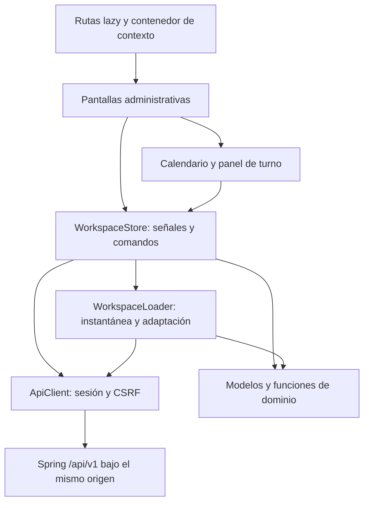

# Frontend Patio: arquitectura y verificación

Fecha: 21/10/2026. Cliente Angular/TypeScript para secretaría y profesional, con igual prioridad para clínica y ejercicio independiente. Dirección visual confirmada: Patio, verde profundo, superficies claras y agenda protagonista.

## Revisión global y correcciones

Se conserva una SPA con componentes standalone, rutas cargadas bajo demanda y señales para el estado compartido. La revisión separó transporte, contratos y adaptación de datos del estado de interacción, y corrigió las respuestas tardías al cambiar contexto.

| Área | Resultado |
| --- | --- |
| Sesión y rutas | Acceso, recuperación, activación, MFA y selección de contexto. Alias `/access/activate` y `/access/reset` compatibles con los enlaces del servidor. Restaurar una sesión pendiente de MFA lleva a MFA. |
| Entidad y facultades | `/workspace` entrega permisos efectivos. Cambiar entidad invalida solicitudes anteriores, cierra detalles y limpia búsqueda y avisos. La etiqueta del rol no concede acciones. |
| Contratos | DTO de lectura tipados en `api-contracts.ts`; `workspace.loader.ts` transforma datos del servidor y publica una instantánea con fallos parciales explícitos. |
| Estado | `WorkspaceStore` concentra contexto, fecha/agenda y comandos. Formularios, filtros de pantalla y pestañas son locales. El contenedor recrea las pantallas al cambiar entidad/usuario. |
| Concurrencia | Versión de contexto para escrituras y detalles, generación de carga para instantáneas y selección de paciente/afiliación/disponibilidad. Se fija la URL de entidad antes de esperar respuestas y se comprueba contexto entre pre-reserva y registro. Respuestas de otro contexto no modifican el actual. |
| Escrituras | Guardado confirmado seguido de fallo de recarga informa «se guardó» y pide actualizar. Una interrupción de red informa resultado incierto sin afirmar que el servidor descartó la acción. |
| Reservas | Pre-reserva y registro separados; claves de idempotencia estables al reintentar el mismo registro/reprogramación. El conflicto del servidor no se convierte en éxito local. |
| Persistencia | Solo datos ficticios y preferencias de demo en `localStorage`. Restaurar demo también reemplaza su copia persistida. Los datos reales permanecen en memoria; `sessionStorage` conserva indicadores de modo/entidad, sin credenciales. |
| Calendario | Día, semana, mes y lista comparten fecha. Zona IANA de la agenda, horas tabulares, estados textuales y selector de profesional en móvil. |
| Fallos | Errores de sesión, MFA, facultades, concurrencia, conexión y secciones parciales visibles. Fallar la carga principal limpia datos y permisos anteriores. |

## Capas

`domain.ts` contiene fechas, zonas horarias, conflictos, facultades y escape CSV sin depender de Angular. `demo-data.ts` genera datos ficticios. Los DTO tipados delimitan el contrato de lectura; no son validación dinámica de respuestas. `ApiClient` usa cookies de mismo origen, obtiene CSRF y adjunta `X-CSRF-TOKEN` en escrituras. El servidor conserva la autoridad de autorización, aislamiento y capacidad.

TypeScript y plantillas se compilan en modo estricto. Las pantallas declaran detección `Eager` para los formularios locales con `ngModel`; el estado compartido usa señales. La estrategia es explícita porque Angular 22 cambió la predeterminada. No se agrega otra biblioteca para duplicar el estado actual.

## Pantallas desarrolladas

| Pantalla | Funciones |
| --- | --- |
| Mi jornada | Fecha, calendario por profesional, próximo turno, pacientes siguientes, consignas disponibles y pendientes accionables. |
| Agenda | Día/semana/mes/lista, profesional y asistencia; detalle, alta, confirmación, cancelación con motivo y reprogramación. |
| Pacientes | Búsqueda por nombre/documento/número, ficha administrativa, contactos verificados, vínculos, afiliaciones, autorizaciones, representantes y acceso según facultad. |
| Solicitudes | Revisar admisiones, aprobar con evidencia, rechazar, coordinar solicitudes asistidas y resolver reprogramaciones vinculadas al turno. |
| Comunicaciones | Avisos internos y tareas de entrega; lectura y reintento en estados admitidos. Ventanas de confirmación documentadas sin fingir envíos. |
| Mensajes | Conversaciones autorizadas, texto y carga de mensajes anteriores. Delegar agenda no habilita chat. |
| Prácticas y coberturas | Catálogo, ofertas versionadas, duración/preparación/cierre, modalidad, cobertura, planes y convenios. |
| Reportes | Período y agenda, CSV de demo y PDF/Excel/CSV del servidor, auditoría paginada. |
| Configuración | Horarios, ausencia y turnos afectados, delegaciones por acción del titular, cuenta, recuperación y MFA. |

Las ausencias no mueven ni cancelan automáticamente turnos. Inician avisos obligatorios por WhatsApp a todos los afectados, incluidos los confirmados. Registro y asistencia son estados separados. Solo la práctica base Consulta puede habilitar autogestión; otras prácticas se coordinan con el equipo. La consigna libre del turno se ofrece en demo: el contrato actual del servidor no tiene ese campo y la UI real no simula su persistencia.

## Lecturas añadidas al servidor

`WorkspaceController` incorpora contexto, referencias de ficha y configuración de cobertura reutilizando autorizador y transacciones por entidad. Los listados de pacientes, turnos afectados y conversaciones añaden campos administrativos necesarios para representar datos ya autorizados. No conceden facultades por rol ni acceso al chat por agenda.

La integración comprueba permisos efectivos, rechazo de ficha sin acceso, revocación de delegación y ocultamiento de integrantes sin facultad. Se prueba con PostgreSQL aislado de Testcontainers, sin cambiar la base del usuario.

## Verificación de la entrega visual anterior

La actualización de integración y sus pruebas están en [documento 28](28-integracion-frontend-servidor-y-pruebas.md). Las cifras inferiores corresponden a la revisión visual previa.

- `npm test`: 5 pruebas aprobadas: límites de calendario, solapamientos, facultades explícitas, zona horaria con horario inexistente y escape de fórmulas CSV.
- `npm run build`: producción aprobada con tipos y plantillas estrictos. Aproximadamente 460 kB iniciales y 118 kB de transferencia estimada en esta ejecución, con pantallas separadas por ruta.
- Servidor `mvnw verify`: 12 pruebas unitarias y 30 de integración aprobadas. Registro local `tmp/frontend-api-verify.log`; migraciones V1–V8 sobre PostgreSQL 18.6 aislado.
- Navegador: creación, confirmación y reprogramación de turno ficticio; ficha y edición, búsqueda sin resultados, modos de calendario, cambio de rol/entidad y limpieza de ficha al cambiar contexto. Sin errores de consola en la ronda final.
- Capturas verificadas en `.impeccable/review`: escritorio 1440×900, ancho del usuario 1280×720, móvil 390×844, profesional, independiente, ficha y formulario móvil. El calendario permite desplazamiento propio para varias agendas.

La revisión independiente se registra en `.impeccable/review/finish-review.md`. Su veredicto final es **ship**: calificó como resueltas navegación móvil por teclado, espaciado del logotipo y contraste del botón destructivo en hover. Las evaluaciones finales se limitan a esas tres correcciones, con capturas actuales de viewport, observaciones de teclado y colores computados; la ronda inicial había revisado capturas completas. El menú cerrado es inerte y queda fuera del acceso asistido; abierto contiene el foco, y Escape lo devuelve al botón de apertura tras el render de Angular. El hover destructivo mantiene texto blanco sobre `#873432`, con contraste medido de 8,18:1.

Los tokens y normas visuales quedan en `DESIGN.md` y `.impeccable/design.json`.

## Límites y continuidad

Entrega del frontend del equipo administrativo y profesional. El portal público del paciente, alta comercial, clínica, odontograma, IA y facturación no forman parte de estas pantallas. Los formularios corresponden a comandos existentes; no inventan ciclos de edición/eliminación que el servidor no expone.

La actualización del documento 28 sustituye el límite anterior de 100: agenda por rango, directorio y listados operativos se recuperan por páginas; Reportes consulta su propio período. Se añadieron pruebas de componentes, estado y recorridos HTTP con MFA; permanece pendiente una suite E2E de navegador de todas las pantallas. Los DTO auxiliares de configuración pueden seguir tipándose al estabilizar contratos. No se afirma cobertura E2E automatizada completa ni accesibilidad certificada.

Google, correo y WhatsApp requieren configuración y pruebas con proveedores. La política automática T-24 conserva el estado configurado del servidor; la UI no activa decisiones pendientes. No se efectuaron despliegue público ni envíos reales. Las pruebas de API aisladas no sustituyen el recorrido de ingreso con las cuentas del entorno elegido.

Para ejecutar en VS Code e integrar Spring, seguir [salud-web/README.md](../salud-web/README.md).
